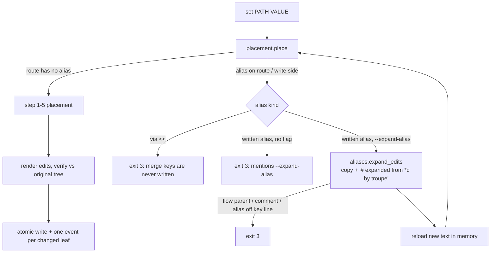

# Implementation Plan: troupe configuration: anchors and aliases stay honest

**Branch**: `fix/troupe-config-anchor-aliases` (delivered to `main` by local merge) | **Date**: 2026-10-06 | **Spec**: [spec.md](spec.md)
**Input**: Feature specification from `kitty-specs/troupe-config-anchor-aliases-01M48SQ8/spec.md` (step 6: contract section *Aliases*; bug `bakeoff-specs-speckitty-qht`)

## Summary

- Files using anchors, aliases and merge keys become loadable. `yamlcore` builds its raw nodes from ruamel's **parser events** with its own small composer. That is the only way to learn where each `*alias` is written, because ruamel's composer hands back the anchored node object itself. Node spans start at the content, not at `&name`, so every existing writer keeps its assumptions.
- The tree gains a transparent **`AliasNode`**, unwrapped like an include, so `get`, `show`, `show --sources`, history leaves and reconcile see resolved values. A mapping holding `<<` becomes a read-only **`MergeKeyMapping`** view over the mapping as written.
- `writeback/placement.py`, the one place that decides where a `set` goes, also decides **"reached through an alias"**:
  - without `--expand-alias` it refuses with exit 3, and stderr mentions `--expand-alias`;
  - with the flag, the new `writeback/aliases.py` replaces the alias with a block-style copy and the troupe comment, the tree is reloaded in memory and placement runs again;
  - through `<<` it refuses with exit 3 whether or not the flag is given.
- The verifier ("value reads back, nothing else changed") learns three rules:
  - an alias that still refers to the same anchor is unchanged;
  - on the route only, and only with the flag, an alias may become a copy;
  - anchor names must not change outside PATH.
- No new dependencies. History, lineage and the event schema are unchanged; C11 follows from leaves being resolved paths.

## Engineering Alignment

Confirmed by the product owner on 2026-10-06 (DM 01M48T5X483RCHEXYJ60R4N35P: "Approved. The alignment matches the contract's Aliases section … The two spec additions are your choice …"). Implementation decisions are R-1…R-10 in [research.md](research.md). Product-level choices are spec A-0 and C1–C14; C13 and C14 were added with this plan, and C9 was extended.

1. **Parsing** (R-1). Our own composer over `YAML(typ="safe", pure=True).parse(text)` records `RawAnchor` (name and span) on raw nodes and turns each alias into `RawAlias` (name, span, anchored raw node). It refuses with exit 4 on:
   - undefined or recursive aliases;
   - any tag;
   - more than one document.

   Spans start at the content (R-2). `values.parse_value` keeps refusing anchors and aliases (exit 2, C14).
2. **Tree** (R-3). `AliasNode(origin, name, target, anchored, merge)` is transparent through `paths.unwrap`. The anchored node is one shared object; `ScalarNode`, `MappingNode` and `SequenceNode` gain `anchor: Anchor | None`.
3. **Merge keys** (R-4). `MergeKeyMapping(MappingNode)` holds `written`, the concrete mapping including its `<<` entry. Its `entries` are the written keys, with the merged-in keys at the position of the `<<` entry, each value wrapped in `AliasNode(merge=True)`. Writers only ever get `written`. The loader refuses with exit 4 a bad `<<` value and a `<<` beside `$ref` (C13).
4. **Load-time restrictions** (R-5). The loader refuses with exit 4: anchors on include references or on nodes containing one, anchored or aliased keys (C3), and tags (C2).
5. **Through-alias detection** (R-6). Only in `placement.place`. It applies to the first `AliasNode` on the walked route, and to the side a new key would be written to (`_on_side`/`_on_base`), which covers aliases inside step-5 override mappings. The result is either `WriteRefused` (exit 3) or an `ExpandAlias` placement when `--expand-alias` is given.
6. **Expansion** (R-7, R-8). `aliases.expand_edits` renders the copy from the anchored node's content in block style:
   - single-line scalars keep their written text;
   - inner aliases stay `*name`;
   - anchors inside the copy are dropped;
   - `  # expanded from *<name> by troupe` goes on the key or dash line.

   It refuses with exit 3 for a flow parent, an existing end-of-line comment, an alias not on its key or dash line, and a merge. `apply_set` loops "expand → reload in memory → place" until placement is ordinary, then sets and verifies once against the original tree. Everything happens in one file.
7. **Anchors on rewritten values** (R-9). Kind-changing replacement (`collections.replace_value_edits`) treats an anchor on the key's line as part of the head, so the anchor is kept (C5). An anchor anywhere else on a replaced collection causes exit 3.
8. **CLI** (R-10). Add `set --expand-alias` as a store-true flag, passed to `apply_set`. Other subcommands reject it (exit 2).



## Technical Context

**Language/Version**: Python 3.12+ managed with uv; package `troupe`, console script `troupe = troupe.cli:main` (unchanged)
**Primary Dependencies**: unchanged (`ruamel.yaml` 0.19.x, only via `troupe.yamlcore`; `eventsourcing` 9.5.x). **No new dependencies**: nothing is added, upgraded or removed, so no supply-chain review is needed. The parser-event API (`YAML.parse`) is part of the already-pinned ruamel.yaml.
**Storage**: user files `<theatre>/.troupe/troupe.yml` and include targets (byte-surgical, atomic temp-file + rename via `writeback.fileio.write_files`); history in `<theatre>/.troupe/` event store (unchanged schema)
**Testing**: pytest. Black-box CLI tests run in subprocesses on real temporary theatres (`make_theatre` fixture) with byte snapshots of every file. Unit tests cover the composer, loader, merge-key view, placement and expansion edits. Gates: `uv run pytest`, `uv run mypy --strict`, `uv run ruff check`, `uv run ruff format --check`.
**Target Platform**: macOS and Linux CLI
**Project Type**: single
**Performance Goals**: none (TROUPE-004). Alias-heavy files expand during reads (see Risks).
**Constraints**: contract as written (C-001); untouched bytes identical (TROUPE-001, NFR-002); refusals change nothing (NFR-003); atomic writes, so an expansion and its set are one write of one file (C-005)
**Scale/Scope**: about 13 source files touched, 1 module added (`troupe/writeback/aliases.py`), about 7 test files added or extended

## Charter Check

| Directive / gate | Status | How |
|---|---|---|
| TROUPE-001 byte-preserving user files | Pass | Expansion replaces only the alias token and appends the copy lines; anchors on replaced values are kept (R-9); the in-memory verifier refuses anything else; tests snapshot every file. |
| TROUPE-002 conservative under uncertainty | Pass | Through an alias → exit 3; through `<<` → always exit 3; expansion refused where a comment or layout would be lost (C9); unsupported anchor uses and `<<` beside `$ref` → exit 4. |
| TROUPE-003 errors name path/file | Pass | Load errors name the file and line; refusals name PATH, the alias (`*d`) and the file. |
| TROUPE-004 fixed tech | Pass | Python 3.12/uv; no new dependencies. |
| TROUPE-005 tests that prove something | Pass | Real CLI and files; test names state their assertion; every A-0/C-n choice has a test. |
| TROUPE-006 done means verified | Pass (at delivery) | All four gates run and shown. |
| TROUPE-007 one decision, one place | Pass | Anchor/alias syntax in `yamlcore`; merge-key semantics in `merge.py`; load restrictions in `loader.py`; "through an alias" in `placement.py`; expansion text in `writeback/aliases.py`. |
| TROUPE-008 whole scope, no invention | Pass | Whole Aliases section in scope; out-of-contract choices recorded as spec A-0, C1–C14 with product-owner confirmation. |
| TROUPE-009 spec/code/tests together | Pass | Spec amended in this planning commit (C9 extension, C13, C14, FR-010); mission contract in `contracts/cli.md`. |

Re-check after design: no violations; Complexity Tracking not needed.

## Project Structure

### Documentation (this mission)

```
kitty-specs/troupe-config-anchor-aliases-01M48SQ8/
├── spec.md
├── plan.md            # this file
├── research.md        # R-1…R-10
├── data-model.md      # Raw nodes, AliasNode, Anchor, MergeKeyMapping, ExpandAlias, invariants
├── quickstart.md      # manual walkthrough of the bug and the fix
├── contracts/cli.md   # Aliases section as delivered, with A-0, C1–C14
├── checklists/requirements.md
└── decisions/
```

### Source Code (repository root)

```
src/troupe/
├── yamlcore.py             # event-based composer: RawAnchor, RawAlias, content-start spans, tag/undefined/recursive refusals
├── tree.py                 # + Anchor, AliasNode, MergeKeyMapping; anchor field on Scalar/Mapping/SequenceNode
├── merge.py                # + MERGE_KEY, merge_keys(written, sources) -> MergeKeyMapping (YAML merge semantics)
├── loader.py               # convert RawAlias -> AliasNode (shared anchored node), C3/C13 refusals, << handling
├── paths.py                # unwrap also unwraps AliasNode
├── leaves.py               # _collect through AliasNode
├── values.py               # parse_value refuses anchors/aliases (C14); scalar_of unwraps
├── yamlout.py              # _content unwraps aliases (show prints resolved values)
├── reconcile.py            # watched_files: AliasNode adds no files; MergeKeyMapping walks written
├── writeback/placement.py  # through-alias detection, ExpandAlias placement, _children skips aliases, merge-key views
├── writeback/aliases.py    # NEW: expand_edits (copy rendering, comment, C9 refusals)
├── writeback/collections.py# replace_value_edits keeps an anchor on the key line (C5)
├── writeback/apply.py      # expand loop, _same_outside alias/anchor rules, expand_alias arg
├── cli.py                  # set --expand-alias
└── commands/set_value.py   # pass expand_alias

tests/
├── unit/test_yamlcore.py                  # composer: anchors, aliases, spans, tags, undefined/recursive aliases
├── unit/test_loader_aliases.py            # NEW: AliasNode sharing, merge-key view, C3/C13 load errors
├── unit/test_alias_expansion.py           # NEW: expand_edits text for mapping/scalar/list item/nested; C9 refusals
├── integration/test_aliases_read.py       # NEW: US1 get/show/--sources; load errors exit 4
├── integration/test_set_aliases.py        # NEW: US2/US3 with byte snapshots and history
├── integration/test_set_expand_alias.py   # NEW: US4 with byte snapshots, history, lineage, exit 2 on other commands
└── integration/test_set_overrides.py      # anchor/tag-on-include tests: message expectations updated (C2/C3)
```

**Structure Decision**: single project, as in steps 1–5. Expansion text gets its own writer module, next to `collections.py`, so the copy and comment rules live in one place. Merge-key semantics join the existing merge module.

## Implementation Concern Map

> Concerns, not work packages.

| ID | Concern | Spec | Notes |
|---|---|---|---|
| IC-01 | Event-based composer | FR-001, FR-002, FR-010, C2, C14 | `yamlcore.py`, `values.py`; spans at content start; refusal messages with line numbers. |
| IC-02 | Tree, loader and merge-key view | FR-001, FR-002, A-0, C1, C3, C13 | `tree.py`, `loader.py`, `merge.py`; readers: `paths`, `leaves`, `yamlout`, `values.scalar_of`, `reconcile`. |
| IC-03 | Placement: through-alias decision | FR-003, FR-004, FR-007, C4, C6, A-0 | `placement.py`: route scan, write-side scan, `ExpandAlias`, merge refusals, concrete parents skip aliases. |
| IC-04 | Expansion edits | FR-005, FR-006, C7, C8, C9 | `writeback/aliases.py`. |
| IC-05 | Apply loop, verification, anchors kept, CLI | FR-003, FR-005, FR-008, FR-009, C5, C10, C11, NFR-002, NFR-003 | `apply.py`, `collections.py`, `cli.py`, `set_value.py`. |
| IC-06 | Tests and docs | NFR-001, NFR-004, C-001, C-003, C12 | New and updated test files; module docstrings; `contracts/cli.md`. |

Dependencies: IC-01 → IC-02 → IC-03 → IC-04 → IC-05. IC-06 spans all.

## Risks

- **Span shift.** Changing where anchored nodes start could break writers that use `origin.start`. Mitigation: R-2 makes anchored spans equal to what an unanchored node would have. The step 1–5 suite runs unchanged, and new unit tests pin spans for anchored block, flow and scalar nodes.
- **Missed `isinstance` dispatch.** Any tree walk without an `AliasNode` branch could silently skip resolved values. Mitigation: R-3 lists every dispatch site (leaves, yamlout, reconcile, values, placement, apply, merge, paths). mypy strict and an exhaustive `assert_never` where practical; integration tests read through aliases with every command.
- **Writing through a shared node by accident.** For example, `concrete_parent` could find an anchored child via an alias, or `_on_side` could write into an aliased override. Mitigation: aliases are never concrete containers (R-6). The verifier also refuses any change visible outside PATH. A change at the anchor shows through aliases only as the same anchor, so the verifier's alias rule compares anchors, not content.
- **Exponential expansion** ("billion laughs"). Reads and history flatten resolved trees, so a deliberately nested file is slow. There are no performance targets (TROUPE-004), so this is documented, not guarded.
- **Existing tests.** The anchor/tag refusal tests from steps 1 and 5 change their message expectations. Every other suite must pass unchanged (C-003).

## Complexity Tracking

None.
