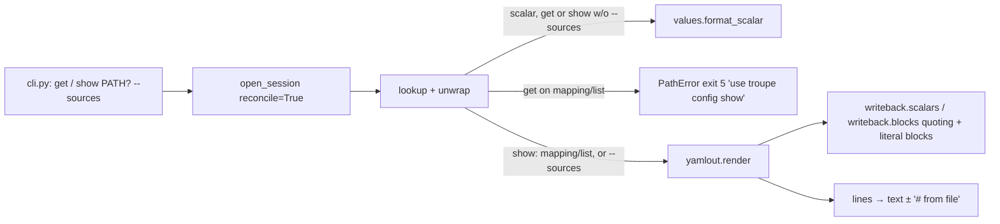

# Implementation Plan: troupe configuration: get for values, show for anything

**Branch**: `feat/troupe-config-get-show` (delivered to `main` by local merge) | **Date**: 2026-10-03 | **Spec**: [spec.md](spec.md)
**Input**: Feature specification from `kitty-specs/troupe-config-get-show-01M411XB/spec.md`

## Summary

- `get PATH` is the step-1/2 `show PATH`, moved under a new name. The only differences are the refusal message for a mapping or list, which now points to `config show`, and its `--help` line.
- `show [PATH] [--sources]` becomes a read-only renderer. A scalar without `--sources` is printed exactly as `get` prints it. Anything else is passed to a new pure module, `troupe/yamlout.py`, which turns a loaded `Node` into block-style YAML text. With `--sources` it appends `# from <file>` to every line that holds a scalar.
- Quoting and literal-block rules are reused from `troupe.writeback.scalars` and `troupe.writeback.blocks`, so `show` and `set` share one decision for how a string is written (TROUPE-007).
- Both commands open a session with `reconcile=True` (unchanged reconcile-first rule) and never write configuration files.

## Engineering Alignment

The PO delegated every contract-open choice ("the choice is yours … as long as you record what you chose"), so no further planning questions were asked. Each choice is recorded in [research.md](research.md) as D-1…D-9.

1. **One renderer, used for both outputs.** `yamlout.render(node, sources)` emits a list of `Line(text, scalar_source | None)`. `--sources` appends the comment to lines whose `scalar_source` is set. Without `--sources` the same lines are joined, so the two outputs differ only by the comments (spec US3 scenario 5, by construction).
2. **The source file is the node's own file.** `ScalarNode.origin.file.path` holds the bytes of the scalar, including the root of a scalar-only YAML include. `TextInclude.target.path` is the included file. Both are made relative to `Theatre.directory` with `os.path.relpath` and `/` separators, and `..` is allowed (D-6).
3. **Layout** follows FR-008 and D-1/D-2. Literal blocks reuse `blocks.literal_header`, `blocks.literal_lines` and `blocks.can_block`. Text a block cannot hold (CR, control characters) is double-quoted (D-4). Floats use `scalars.render_nonstring`, which gives `.inf`/`.nan` (D-3).
4. **Self-check:** every rendering is verified by tests that parse it back. The command code has no runtime check (D-8).
5. **Test churn:** the step-1 `show` scalar tests move to `tests/integration/test_get.py`, renamed `test_get_*`. Helpers in the other integration tests that read values switch to `get`. `show` gets new tests (D-9).



## Technical Context

**Language/Version**: Python 3.12+ managed with uv; package `troupe`, console script `troupe = troupe.cli:main` (unchanged)
**Primary Dependencies**: unchanged (`eventsourcing` 9.5.x, `ruamel.yaml` 0.19.x). **No new dependencies.** The YAML is emitted by our own code, not `ruamel.yaml`'s dumper, so the layout decisions stay in one module (research R-1). No supply-chain review is needed because no dependency is added, upgraded or removed.
**Storage**: N/A. Reads the configuration files; `.troupe/history.sqlite` changes only through the existing reconcile-first session.
**Testing**: pytest. Black-box CLI tests on real temporary theatres (`tests/integration/test_get.py`, `test_show.py`, `test_show_sources.py`) with exact stdout bytes, and every `show` output parsed back with `ruamel.yaml` (safe) and compared with the resolved data. Unit tests for `troupe/yamlout.py` (`tests/unit/test_yamlout.py`). Gates: `uv run pytest`, `uv run mypy --strict`, `uv run ruff check`, `uv run ruff format --check`.
**Target Platform**: macOS and Linux CLI
**Project Type**: single
**Performance Goals**: none beyond step 1/2 (rendering is linear in configuration size)
**Constraints**: read-only for configuration files (FR-014, C-003); exit-code and stderr discipline unchanged (NFR-002)
**Scale/Scope**: about 4 source files touched or added; about 4 test files added or rewritten, plus mechanical helper switches

## Charter Check

| Directive / gate | Status | How |
|---|---|---|
| TROUPE-001 byte-preserving user files | Pass | `get`/`show` never write configuration files; test asserts snapshot equality before/after. |
| TROUPE-002 conservative under uncertainty | Pass | Text a literal block cannot hold exactly falls back to double quotes, so data is never altered (D-4). |
| TROUPE-003 errors name path/file | Pass | `get` refusal names PATH and says `troupe config show PATH`; missing path errors unchanged. |
| TROUPE-004 fixed tech | Pass | Python 3.12/uv; no new deps. |
| TROUPE-005 tests that prove something | Pass | Exact-bytes CLI tests plus parse-back equality; each test name states its assertion. |
| TROUPE-006 done means verified | Pass (at delivery) | All four gates run and shown before claiming done. |
| TROUPE-007 one decision, one place | Pass | Layout constants in `yamlout.py`; quoting/literal rules reused from `writeback.scalars`/`writeback.blocks`; source-path rule one function `source_label`; refusal wording one constant in `commands/get.py`. |
| TROUPE-008 whole scope, no invention | Pass | Out-of-contract choices recorded (DM 01M411YHFR2PMJEJWMHX4KN9C4, D-1…D-9). |
| TROUPE-009 spec/code/tests together | Pass | Spec FR-008 amended for float specials (D-3) in this plan commit; contract `contracts/cli.md` updated. |

Re-check after design: no violations; Complexity Tracking not needed.

## Project Structure

### Documentation (this mission)

```
kitty-specs/troupe-config-get-show-01M411XB/
├── spec.md
├── plan.md            # this file
├── research.md        # D-1…D-9 decisions, R-1 renderer choice
├── data-model.md      # Line / source label model, layout rules
├── quickstart.md      # manual walkthrough
├── contracts/cli.md   # updated CLI contract (get, show [PATH] [--sources])
└── decisions/         # DM 01M411YHFR2PMJEJWMHX4KN9C4
```

### Source Code (repository root)

```
src/troupe/
├── cli.py               # register get; show PATH optional + --sources; help text; COMMAND_MODULES
├── values.py            # + scalar_of(node): Scalar | None (shared by get and show)
├── yamlout.py           # NEW: render(node, sources) -> list[Line]; to_text(lines, with_sources)
└── commands/
    ├── get.py           # NEW: today's show.py logic; refusal mentions `troupe config show`
    └── show.py          # REWRITTEN: scalar → format_scalar; else yamlout

tests/
├── unit/test_yamlout.py              # NEW: layout, quoting, blocks, sources, parse-back
└── integration/
    ├── test_get.py                   # moved from test_show.py (scalar cases) + refusal wording
    ├── test_show.py                  # REWRITTEN: sections, whole config, scalar == get
    ├── test_show_sources.py          # NEW: --sources lines, paths, text includes, scalar PATH
    ├── test_cli_basics.py            # missing-PATH usage check moves to get; help lists get
    └── (test_reconcile_first, test_set_*, test_watch_*, test_history)  # value-read helpers → get
```

**Structure Decision**: single project, as in steps 1–2. A new pure module sits next to `values.py`, and the commands stay thin.

## Implementation Concern Map

> Concerns, not work packages.

| ID | Concern | Spec | Notes |
|---|---|---|---|
| IC-01 | `get` command + CLI wiring | FR-001–FR-003, FR-013–FR-015, NFR-004 | Move logic; refusal message constant; `scalar_of` in `values.py`; parser: `get PATH`, `show [PATH] [--sources]`. |
| IC-02 | YAML renderer `yamlout.py` | FR-005–FR-008, NFR-001 | Pure; Line model; layout per data-model.md; reuse writeback quoting/blocks; key quoting (D-5). |
| IC-03 | Source attribution | FR-009–FR-012 | `source_label(file, theatre_dir)`; comment on scalar lines and block headers only; scalar PATH with `--sources` (DM). |
| IC-04 | `show` command | FR-004–FR-006, FR-012–FR-014 | Dispatch scalar vs. render; whole configuration when PATH omitted. |
| IC-05 | Test migration & contract docs | NFR-002–NFR-004, C-004 | Move step-1 show tests to get; switch helpers; rewrite show tests; update contract. |

Dependencies: IC-02 → IC-03 → IC-04; IC-01 is independent of IC-02/03, and IC-04 uses `scalar_of` from IC-01. IC-05 spans all of them.

## Complexity Tracking

None.
