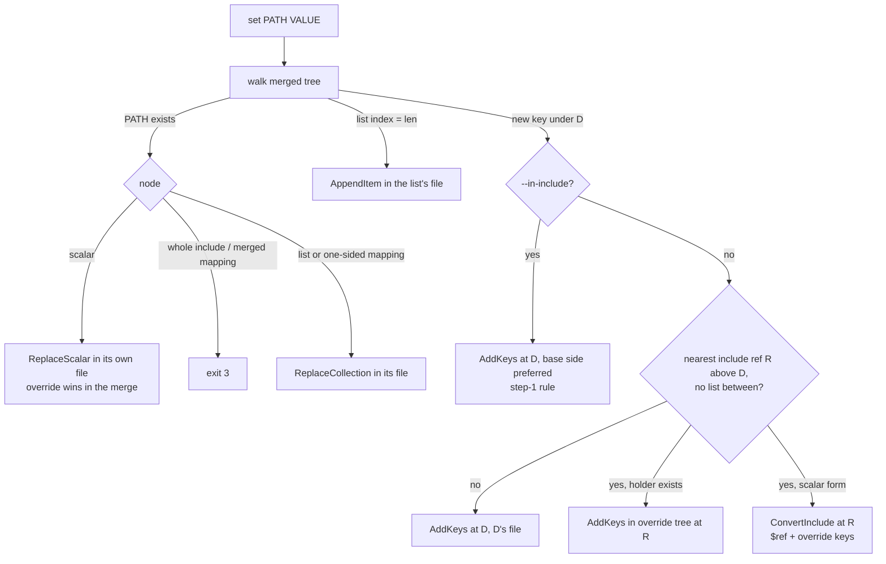

# Implementation Plan: troupe configuration: keep shared includes shared

**Branch**: `feat/troupe-config-include-overrides` (delivered to `main` by local merge) | **Date**: 2026-10-05 | **Spec**: [spec.md](spec.md)
**Input**: Feature specification from `kitty-specs/troupe-config-include-overrides-01M46FY4/spec.md` (step 5: CR-A Overrides, CR-B In-include)

## Summary

- The loader recognises **mapping-form includes** (`$ref` plus overrides) and builds a **merged mapping**: a read-only view that behaves like an ordinary mapping to every reader, so `get`, `show`, `show --sources`, history and reconcile work with almost no change. The view keeps both sides (included and override) so the writer can tell where each key lives.
- `writeback/placement.py`, the single place that decides where a `set` writes, replaces step-1 rule 2: a new key under an included section becomes an **override** at the include reference nearest the key's deepest existing ancestor, converting a scalar-form include to mapping form first. `set --in-include` keeps the step-1 rule.
- The existing safety net (re-load in memory, check read-back and "nothing else changed" before writing) stays, with one allowance: on the route to PATH a scalar-form include may become mapping form pointing at the same target.
- No new dependencies. History and lineage are unchanged.

## Engineering Alignment

Confirmed by the product owner on 2026-10-05 (DM 01M46GE1PATR2GJF9SGQ9NAWQ1: "Approved. The alignment matches the contract's Overrides and In-include sections and the answers already given in this step."). Implementation decisions are R-1…R-8 in [research.md](research.md); the product-level choices are spec D-1…D-11.

1. **Loading** (R-1, R-2). A mapping with a `$ref` key is an include. With no other keys it loads exactly like the scalar form; the include node remembers its *holder* mapping so later overrides go there without converting again. With other keys the target must be YAML whose content is a mapping (else exit 4: spec D-1, D-7, contract) and the result is a `MergedMapping`, a `MappingNode` subclass holding `base`, `override` and `ref`. Nested mappings merge the same way; anything else in the override replaces. Keys: included first, then override-only. Every scalar keeps its own origin, so `--sources` is right without change. `watched_files` covers both sides of every merge.
2. **Placement** (R-3, R-4). Existing scalar → its own file (the override when present). List append → the list's file. New key: find the nearest include reference R above the deepest existing ancestor D; if a list lies between R and D → D's file (step-1); else an override at R, extending any override mapping that already exists along the route, converting a scalar-form include first (block, flow, list item; spec D-2…D-5, D-11). `--in-include` → step-1 rule, preferring the base side of a merged mapping (spec D-8). PATH with a `$ref` segment → exit 3 (D-6); replacing a whole include → exit 3; replacing a merged (partly overridden) mapping → exit 3 (D-10).
3. **Verification** (R-5). `_same_outside` accepts, on the route to PATH only, a `YamlInclude` (scalar or holder form) becoming a `MergedMapping` with the same `ref` target, and compares `ref` targets of merged mappings everywhere.
4. **CLI** (R-6). `set --in-include` (store-true); other subcommands reject it via argparse (exit 2).
5. **Tests** (R-8). Real files, real CLI, real event store; byte snapshots of every file in the theatre. Two step-1 tests change expectation because Overrides replaces rule 2.



## Technical Context

**Language/Version**: Python 3.12+ managed with uv; package `troupe`, console script `troupe = troupe.cli:main` (unchanged)
**Primary Dependencies**: unchanged (`ruamel.yaml` 0.19.x via `troupe.yamlcore`, `eventsourcing` 9.5.x). **No new dependencies**; nothing added, upgraded or removed, so no supply-chain review is needed.
**Storage**: user files `<theatre>/.troupe/troupe.yml` and include targets (byte-surgical, atomic temp-file + rename via `writeback.fileio.write_files`); history in `<theatre>/.troupe/history.sqlite` (unchanged schema)
**Testing**: pytest; black-box CLI tests in subprocesses on real temporary theatres (`make_theatre` fixture) with byte snapshots of every file; unit tests for loader merge, placement and conversion edits. Gates: `uv run pytest`, `uv run mypy --strict`, `uv run ruff check`, `uv run ruff format --check`.
**Target Platform**: macOS and Linux CLI
**Project Type**: single
**Performance Goals**: none (TROUPE-004)
**Constraints**: contract as written (C-001); untouched bytes identical (TROUPE-001, NFR-002); refusals change nothing (NFR-003); atomic writes, a conversion and its override are one write of one file (C-005)
**Scale/Scope**: about 9 source files touched, 1 module added (`troupe/merge.py`), about 6 test files added or extended

## Charter Check

| Directive / gate | Status | How |
|---|---|---|
| TROUPE-001 byte-preserving user files | Pass | Overrides are inserted with the existing renderers; conversion moves the include bytes verbatim and keeps the comment gap (D-5); the in-memory verifier refuses anything else; tests snapshot every file. |
| TROUPE-002 conservative under uncertainty | Pass | Malformed `$ref` → exit 4; `$ref` paths, partly overridden mappings and multi-line include strings → exit 3 with no file changed. |
| TROUPE-003 errors name path/file | Pass | New load errors name the file and the `$ref` path; new refusals name PATH and the file. |
| TROUPE-004 fixed tech | Pass | Python 3.12/uv; no new dependencies. |
| TROUPE-005 tests that prove something | Pass | Real CLI and files; test names state their assertion; each D-n has a test. |
| TROUPE-006 done means verified | Pass (at delivery) | All four gates run and shown. |
| TROUPE-007 one decision, one place | Pass | `$ref` recognition and merge in `merge.py`/`loader.py`; where a write goes in `placement.py`; conversion text in `writeback/collections.py` (`convert_include_edits`). |
| TROUPE-008 whole scope, no invention | Pass | Both CRs in scope; out-of-contract choices recorded in spec D-1…D-11. |
| TROUPE-009 spec/code/tests together | Pass | Spec amended in this planning commit (D-7 correction, D-10, D-11); mission contract in `contracts/cli.md`. |

Re-check after design: no violations; Complexity Tracking not needed.

## Project Structure

### Documentation (this mission)

```
kitty-specs/troupe-config-include-overrides-01M46FY4/
├── spec.md
├── plan.md            # this file
├── research.md        # R-1…R-8
├── data-model.md      # MergedMapping, holder, placements, invariants
├── quickstart.md      # manual walkthrough
├── contracts/cli.md   # Overrides + In-include as delivered, with D-1…D-11
├── checklists/requirements.md
└── decisions/
```

### Source Code (repository root)

```
src/troupe/
├── tree.py                 # + MergedMapping(MappingNode): base, override, ref; YamlInclude/TextInclude.holder
├── merge.py                # NEW: REF_KEY, deep_merge(base, override) -> MergedMapping (pure)
├── loader.py               # $ref recognition, D-1/D-7/non-YAML-sibling load errors, builds merged mappings
├── paths.py                # docstring only (merged mapping is a MappingNode)
├── reconcile.py            # watched_files covers base, override and ref target of merged mappings
├── writeback/placement.py  # new-key rule (override / step-1 / --in-include), ConvertInclude, D-6, D-10
├── writeback/collections.py# convert_include_edits (block, flow, list item; D-2..D-5, D-11)
├── writeback/apply.py      # dispatch ConvertInclude; _same_outside conversion allowance; in_include arg
├── cli.py                  # set --in-include
└── commands/set_value.py   # pass in_include

tests/
├── unit/test_merge.py                      # NEW: deep merge order/replace rules
├── unit/test_placement_overrides.py        # NEW: nearest include ref, list rule, --in-include, D-6/D-10
├── unit/test_collections.py                # + conversion edits
├── integration/test_loading_ref.py         # NEW: mapping form loads, D-1, D-7, non-YAML siblings, cycles
├── integration/test_set_overrides.py       # NEW: US2/US3 scenarios with byte snapshots
├── integration/test_set_in_include.py      # NEW: US4
├── integration/test_show_sources.py        # + override attribution
├── integration/test_watch_includes.py      # + $ref targets watched / reconciled
└── integration/test_set_new_entries.py     # 2 tests updated (Overrides replaces rule 2)
```

**Structure Decision**: single project, as in steps 1–4. The merge rule gets its own small pure module so it is decided in one place; the loader only recognises `$ref` and calls it.

## Implementation Concern Map

> Concerns, not work packages.

| ID | Concern | Spec | Notes |
|---|---|---|---|
| IC-01 | Mapping-form loading and merge | FR-001–FR-004, D-1, D-7 | `tree.py`, `merge.py`, `loader.py`; reads (`get`/`show`/`--sources`), `leaves.flatten`, `watched_files`. |
| IC-02 | Placement of new keys and refusals | FR-005, FR-007–FR-010, FR-012, D-6, D-8, D-10 | `placement.py`: nearest include ref, list rule, override tree extension, `--in-include`. |
| IC-03 | Include conversion edits | FR-006, D-2–D-5, D-11 | `collections.convert_include_edits`: block, flow, list item; comment gap; indentation. |
| IC-04 | Verification and wiring | FR-011, FR-013, NFR-002, NFR-003 | `apply.py` dispatch + `_same_outside` allowance; `cli.py`/`set_value.py` `--in-include`. |
| IC-05 | Tests and docs | NFR-001, NFR-004, C-001, C-003 | New test files; update 2 step-1 tests; module docstrings; `contracts/cli.md`. |

Dependencies: IC-01 → IC-02 → IC-03 → IC-04. IC-05 spans all.

## Risks

- **Verifier false refusals**: conversion changes node kinds on the route; the allowance must be exactly "same ref target, merged view equals old content plus the added key", or legitimate sets are refused (exit 3) — safe but wrong. Covered by integration tests for every conversion form.
- **Merged mapping origin**: code that uses a mapping's `origin` to write (insertion point, entry column) must never receive a `MergedMapping`; placement always resolves to a concrete side. Guarded by an assertion in `apply._edits` and by type (placements carry concrete `MappingNode`s).
- **Existing tests**: two step-1 expectations change by contract; all other suites (watch, history, lineage, show) must pass unchanged (C-003).

## Complexity Tracking

None.
