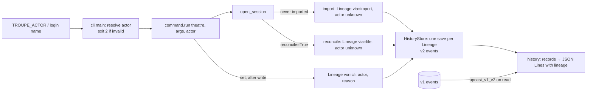

# Implementation Plan: troupe configuration: lineage for every change

**Branch**: `feat/troupe-config-lineage` (delivered to `main` by local merge) | **Date**: 2026-10-04 | **Spec**: [spec.md](spec.md)
**Input**: Feature specification from `kitty-specs/troupe-config-lineage-01M436R0/spec.md`

## Summary

- Every history event recorded from now on stores its lineage: actor kind, actor id, via, at, reason and change. The three leaf event classes of `ConfigHistory` move to `class_version = 2` and gain these fields.
- Events recorded before this step (version 1) are upgraded **when they are read**, by the event store's upcasting hook (`upcast_v1_v2`). The stored database is never rewritten (spec DM 01M436RBNQT22F9AM54QER2FT9, C-005).
- A new module, `troupe/lineage.py`, owns every lineage decision: reading and checking `TROUPE_ACTOR`, the login-name fallback, the clock, change-id minting, and the three lineage constructors (import, file, cli).
- Each producer (import, file reconcile, CLI command) builds **one** `Lineage` value and saves all its events with it in one atomic `save()`. The events therefore share `change`, `at`, `actor`, `via` and `reason` by construction.
- `troupe config history` appends `actor, via, at, reason, change` to each line. `set` gains `--reason TEXT`.

## Engineering Alignment

Confirmed by the product owner on 2026-10-04 ("Approved. The approach agrees with the Lineage section and the step 4 brief."). Each choice is recorded in [research.md](research.md) as D-1…D-9.

1. **Lineage lives on each event** (D-1). The new version-2 fields are `actor_kind`, `actor_id`, `via`, `at`, `reason` and `change`. Old events are upgraded when read (D-2): actor unknown/null, `reason` null, `via` `"import"` or `null`, `at` the stored event timestamp converted to UTC, and `change` `pre-lineage-<seq>`.
2. **One module decides lineage** (D-3…D-6). Change ids are `uuid4` strings. `at` is read once per producer and formatted `YYYY-MM-DDTHH:MM:SS.ffffffZ`. `TROUPE_ACTOR` must be `human:<id>` or `agent:<id>`, where the id is everything after the first `:` and must be non-empty. When the variable is unset, the actor is `getpass.getuser()`, or `null` if that fails or returns an empty name.
3. **How the actor reaches commands** (D-7). `cli.main` resolves the actor after argument parsing and before `locate` (spec DM 01M436TPQDWVSZQYFD6D5343DC), and passes it to `Command.run`. The session gives an import its import lineage. `reconcile.reconcile` gives a reconcile its file lineage. `set` builds a cli lineage carrying its reason.
4. **History output** (FR-001). Key order is `seq, op, path, old, new, actor, via, at, reason, change`. The PATH filter is unchanged.
5. **Tests** use the real CLI, real files and the real event store. Old-event behaviour is tested against a fixture database recorded by the step-3 code at commit `a589041`, kept with the script that regenerates it (D-9).



## Technical Context

**Language/Version**: Python 3.12+ managed with uv; package `troupe`, console script `troupe = troupe.cli:main` (unchanged)
**Primary Dependencies**: unchanged (`eventsourcing` 9.5.x, `ruamel.yaml` 0.19.x). **No new dependencies.** It uses the standard library's `uuid`, `getpass` and `datetime`. No dependency is added, upgraded or removed, so no supply-chain review is needed.
**Storage**: `<theatre>/.troupe/history.sqlite` through `eventsourcing.sqlite`. The event classes gain fields under `class_version = 2`. Old version-1 rows are upcast when read and never rewritten. Event class names and topics stay exactly as they are, because stored events are found by topic.
**Testing**: pytest. Black-box CLI tests run in subprocesses with a controlled environment (`TROUPE_ACTOR`, `LOGNAME`/`USER`) on real temporary theatres. Unit tests for `troupe/lineage.py`. Store tests against the real eventsourcing library, including the committed pre-lineage fixture database. Gates: `uv run pytest`, `uv run mypy --strict`, `uv run ruff check`, `uv run ruff format --check`.
**Target Platform**: macOS and Linux CLI
**Project Type**: single
**Performance Goals**: none (TROUPE-004)
**Constraints**: the contract is unchanged (C-001); configuration files are not touched beyond what `set` was asked to change (NFR-002); stored events are not rewritten (C-005); one atomic save per change (NFR-001)
**Scale/Scope**: about 8 source files touched, 1 module added, about 5 test files added or extended, 1 binary fixture

## Charter Check

| Directive / gate | Status | How |
|---|---|---|
| TROUPE-001 byte-preserving user files | Pass | Lineage lives only in the history database; existing write-back is unchanged; tests snapshot configuration files around invalid-actor and read-only runs. |
| TROUPE-002 conservative under uncertainty | Pass | Old events are upgraded on read, never rewritten; a bad actor is refused before anything is located, loaded or recorded; an unknown author or login name is `null`, never guessed. |
| TROUPE-003 errors name path/file | Pass | The single new error names `TROUPE_ACTOR` and quotes the bad value (PO-accepted). |
| TROUPE-004 fixed tech | Pass | Python 3.12/uv, eventsourcing; no new dependencies. |
| TROUPE-005 tests that prove something | Pass | Real CLI, real store and a real step-3 database; test names state their assertion. |
| TROUPE-006 done means verified | Pass (at delivery) | All four gates run and their output shown. |
| TROUPE-007 one decision, one place | Pass | Actor grammar, login fallback, clock format, change-id format and per-producer lineage live in `lineage.py`; old-event mapping lives in `ConfigHistory.*.upcast_v1_v2`; JSON key order lives in `commands/history.py`. |
| TROUPE-008 whole scope, no invention | Pass | Out-of-contract choices are recorded in the spec (3 DMs) and research D-1…D-9. |
| TROUPE-009 spec/code/tests together | Pass | The mission contract in `contracts/` describes the delivered behaviour; spec unchanged by planning. |

Re-check after design: no violations, so Complexity Tracking is not needed.

## Project Structure

### Documentation (this mission)

```
kitty-specs/troupe-config-lineage-01M436R0/
├── spec.md
├── plan.md                          # this file
├── research.md                      # D-1…D-9
├── data-model.md                    # Actor, Lineage, event v2 fields, upcast mapping, invariants
├── quickstart.md                    # manual walkthrough
├── contracts/
│   ├── cli.md                       # TROUPE_ACTOR, set --reason, history line format
│   └── history-event.schema.json    # history line schema including Lineage
└── decisions/                       # specify DMs
```

### Source Code (repository root)

```
src/troupe/
├── lineage.py           # NEW: Actor, Lineage, resolve_actor(env), import_/file_/cli_lineage, now/at format, change ids
├── history.py           # events class_version 2 + upcast_v1_v2; import_leaves/record take Lineage; HistoryRecord.lineage
├── session.py           # import with import lineage
├── reconcile.py         # reconcile records with a fresh file lineage
├── cli.py               # resolve actor before locate; set --reason; pass actor to Command.run
└── commands/
    ├── set_value.py     # cli lineage (actor, reason) for its own events
    ├── history.py       # lineage keys in output
    ├── get.py, show.py  # Command.run signature only
    └── watch.py         # unchanged behaviour (each reconcile session = own change); docstring

tests/
├── unit/test_lineage.py                     # NEW: actor grammar, login fallback, at format, change ids
├── unit/test_history_store.py               # + lineage persisted, shared per save, upcast of v1 rows
├── fixtures/pre_lineage/                    # NEW: troupe.yml + history.sqlite from a589041, make_fixture.py
└── integration/
    ├── test_lineage_cli.py                  # NEW: set actor/reason/via, TROUPE_ACTOR errors for every command
    ├── test_lineage_changes.py              # NEW: import/file/cli change grouping, watch reconciles, restarts
    ├── test_lineage_pre_lineage.py          # NEW: old history read + appended
    └── test_history.py                      # updated expected lines (key order, lineage)
```

**Structure Decision**: single project, as in steps 1–3. One new pure-ish module (`lineage.py`, which reads only the clock and the login lookup) sits next to `history.py`, and the commands stay thin.

## Implementation Concern Map

> Concerns, not work packages.

| ID | Concern | Spec | Notes |
|---|---|---|---|
| IC-01 | Lineage module | FR-002–FR-005, FR-007, FR-009 | `Actor`, `Lineage`, `resolve_actor`, constructors, clock and change-id formats (D-3…D-6). |
| IC-02 | History store v2 + upcast | FR-001, FR-005–FR-007, FR-012, FR-013, NFR-001, NFR-004, C-005 | New event fields, `upcast_v1_v2`, store methods take `Lineage`, `HistoryRecord.lineage`; topics unchanged. |
| IC-03 | Producer wiring | FR-003, FR-006, FR-008, FR-010, FR-011, FR-014 | `cli.main` actor resolution before `locate`; `set --reason`; session/reconcile/set lineages; `Command.run` signature. |
| IC-04 | History output | FR-001 | Key order; actor as object; unchanged filter. |
| IC-05 | Tests, fixture and contract docs | NFR-002–NFR-005, C-001, C-003 | Pre-lineage fixture + generator; update existing history expectations; `contracts/`. |

Dependencies: IC-01 → IC-02 → IC-03 → IC-04. IC-05 spans all of them; the fixture can be built first.

## Risks

- **Topic stability**: renaming or moving an event class would make old rows unreadable. Constraint: keep `troupe.history:ConfigHistory.LeafImported/LeafSet/LeafRemoved` and `Created` exactly as they are. The pre-lineage fixture test guards this.
- **Event timestamp timezone**: eventsourcing stamps events in `TZINFO_TOPIC`, which defaults to UTC but is read from the environment. Upgraded `at` values are converted with `astimezone(UTC)`. New events carry their own `at` string, so they do not depend on it.
- **Existing tests**: `tests/integration/test_history.py` and `tests/integration/test_set_history.py` compare whole lines and must be updated. Lineage fields that vary (`at`, `change`) are checked by shape and equality grouping, not by literal value.

## Complexity Tracking

None.
