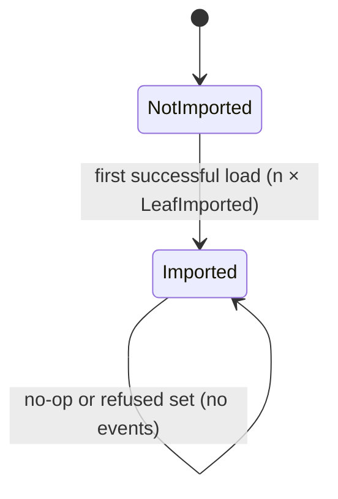

# Data Model: troupe configuration: load, show, set

## Source tree (in memory, rebuilt from disk every command)

| Entity | Fields | Notes |
|---|---|---|
| `SourceFile` | `path` (absolute, resolved), `text` (decoded UTF-8, original newlines, BOM kept as U+FEFF — R-14) | One per file read; newline (`fileio.detect_newline`) and indent step (`collections.detect_indent`) are derived from `text` when needed |
| `Origin` | `file: SourceFile`, `start: int`, `end: int` (code-point indices), `style` | Where a node's bytes live |
| `MappingNode` | `origin`, `flow: bool`, `entries: list[(key: str, key_origin, value: Node)]` | Ordered; keys are strings in contract |
| `SequenceNode` | `origin`, `flow: bool`, `items: list[Node]` | |
| `ScalarNode` | `origin`, `value: str|int|float|bool|None`, `style: plain|single|double|literal|folded` | |
| `YamlInclude` | `origin` (the `file:` string), `target: SourceFile`, `root: Node` | Whole-value YAML include → `set` on it refused (exit 3) |
| `TextInclude` | `origin` (the `file:` string), `target: SourceFile` | Value = target text exactly; a leaf; `set` rewrites the target (R-16) |

Invariants:
- Every node knows the single file that contains its bytes; a node reached through a YAML include
  belongs to the included file.
- Include resolution tracks the stack of real paths; revisiting one on the current stack is a cycle → `LoadError` (exit 4) naming the file.
- Paths: `segments: list[str]`; digit-only segment indexes a `SequenceNode`; key lookup in `MappingNode`.

## Leaves

`flatten(node, prefix) -> dict[str, JsonScalar]` in document order: scalars and `TextInclude`
contents are leaves; sequences contribute `prefix.i`. Empty mappings/lists contribute no leaves.

`diff(before, after) -> list[Change]`: for each path in `after` whose value differs from (or is absent
in) `before` → `Change(op="set", old=before.get(path), new=value)`; for each path in `before` absent
in `after` → `Change(op="remove", old=value, new=None)`. Order: `after` order, then removals in
`before` order. Equality is type-aware (`1` ≠ `1.0` ≠ `"1"`, `True` ≠ `1`).

## History (persisted, `<theatre>/.troupe/history.sqlite`)

Aggregate `ConfigHistory` (eventsourcing `Aggregate`, fixed id per database):

| Event | Fields | Emitted when |
|---|---|---|
| `Created` | — | first import (not listed by `history`) |
| `LeafImported` | `path`, `new` | import, one per leaf |
| `LeafSet` | `path`, `old`, `new` | set changed/created a leaf |
| `LeafRemoved` | `path`, `old` | set removed a leaf |

Listing: event with aggregate version `v` has `seq = v - 1`; output record
`{"seq", "op": import|set|remove, "path", "old", "new"}` (`old` null for import, `new` null for remove).
Events of one command are saved in one `save()` call (atomic).

## Write plan (transient)

`WritePlan = { files: dict[SourceFile, new_text] }` produced by `writeback.apply_set` or a
`TroupeError`. No I/O happens until the plan is complete.

## Errors (`errors.py`, single source of exit codes)

| Class | Exit | Message must name |
|---|---|---|
| `UsageError` | 2 | the argument problem |
| `WriteRefused` | 3 | config path and file |
| `LoadError` | 4 | file (root, include target, or both root names) |
| `PathError` | 5 | config path |
