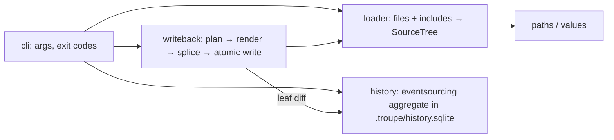

# Implementation Plan: troupe configuration: load, show, set

**Branch**: `feat/troupe-config-load-show-set` (delivered to `main` by local merge) | **Date**: 2026-10-02 | **Spec**: [spec.md](spec.md)
**Input**: Feature specification from `kitty-specs/troupe-config-load-show-set-01M3XGPG/spec.md`

## Summary

Deliver `troupe config show|set|history` for a theatre whose configuration is `.troupe/troupe.yml`
(or `.yaml`) plus recursive `file:` includes. Files on disk are always the source of truth
(spec FR-008). `set` is **byte-surgical**: a span-locating YAML parse finds the target node's exact
character range, a rules engine produces only the replacement text, which is spliced into the
original file text and written atomically — the document is never re-serialised (decision
DM-01M3XGW5Z97R8VC909JF3TVPTT). Per-leaf change history is held as an event-sourced aggregate with the
`eventsourcing` library, persisted in SQLite at `.troupe/history.sqlite` (decision
DM-01M3XGX935C4759B9DMK0BXXKT).

## Engineering Alignment (confirmed 2026-10-02)

- Components with one responsibility each: `cli`, `loader`, `paths`/`values`, `writeback`, `history`.
- `set` order: load → resolve target and placement (refusals here change nothing) → build new
  file texts → atomic write → diff leaves before/after → append events. If the write fails no event
  is appended; a no-op `set` writes nothing and appends nothing.
- Black-box CLI tests against real temp theatres with whole-file byte comparison; history tests use
  the real `eventsourcing` SQLite store.
- Implementer choices (recorded in research.md): encoding and CRLF detected from existing bytes;
  file indentation from the first indented block (default 2); event paths are dotted paths in the
  merged configuration tree.



## Technical Context

**Language/Version**: Python 3.12+ (developed on 3.12.14), managed with uv (0.12.x); package `troupe`, console script `troupe = troupe.cli:main`
**Primary Dependencies**: `eventsourcing` 9.5.x (event store/aggregate, SQLite persistence module); `ruamel.yaml` 0.19.x used **only** to compose node graphs with start/end marks and scalar/collection styles, and to parse `VALUE` as YAML 1.2 core — never to dump user files
**Storage**: user YAML/text files (edited in place via splice + temp-file-and-rename); `<theatre>/.troupe/history.sqlite` (eventsourcing `SQLiteFactory`, `PERSISTENCE_MODULE=eventsourcing.sqlite`, `SQLITE_DBNAME` set to that path; journal files stay in `.troupe/`)
**Testing**: pytest; black-box tests invoke the CLI (`subprocess` running `troupe` from the uv environment, plus an in-process `main(argv)` entry for speed) against temporary theatres; every `set` test asserts complete expected bytes for every file in the theatre; unit tests for pure renderers (quoting, folding, comment columns); `mypy --strict`; `ruff check`; `ruff format --check`
**Target Platform**: macOS and Linux CLI
**Project Type**: single
**Performance Goals**: none (charter TROUPE-004: no performance targets)
**Constraints**: byte-surgical write-back (FR-014); state only under `<theatre>/.troupe/` (NFR-003); refused/failed commands change no file and append no event (NFR-002); every error names a path or file (NFR-005)
**Scale/Scope**: hand-edited configuration files (tens to hundreds of lines), single user, no concurrent writers (out of contract)

## Charter Check

*GATE: Must pass before Phase 0 research. Re-checked after Phase 1 design — still passing.*

| Charter rule | How the plan satisfies it | Status |
|---|---|---|
| TROUPE-001 byte-for-byte preservation | Span splice, no re-serialisation; whole-file byte assertions in every `set` test | Pass |
| TROUPE-002 conservative, data-safe | Refuse (exit 3/5) rather than guess; atomic temp+rename per file; all new texts computed before any write | Pass |
| TROUPE-003 errors name path/file | `TroupeError` carries the path/file; CLI prints it; tested for each exit code | Pass |
| TROUPE-004 fixed constraints | Python 3.12/uv, `eventsourcing`, `.troupe/troupe.yml|yaml`, macOS/Linux | Pass |
| TROUPE-005 real tests | Real files, real CLI, real `eventsourcing` SQLite; no mocks of the store | Pass |
| TROUPE-006 gates shown | pytest, mypy --strict, ruff check, ruff format --check run per WP and at delivery | Pass |
| TROUPE-007 one decision, one place | Exit codes in `errors.py`; quoting choice in `writeback/scalars.py`; placement (step-5-volatile FR-011) in `writeback/placement.py`; include detection in `loader.py` | Pass |
| TROUPE-008/009 no invented requirements | Open choices recorded in research.md; spec/code/tests updated together | Pass |
| DIRECTIVE_001/024 boundaries, locality | Five components with explicit interfaces (data-model.md) | Pass |
| DIRECTIVE_036 black-box integration testing | CLI-level tests are the primary acceptance suite | Pass |

Supply chain: two new runtime dependencies (`eventsourcing`, `ruamel.yaml`) and dev tools (`pytest`,
`mypy`, `ruff`) from PyPI via uv with a committed `uv.lock` (hash-pinned). Both runtime packages are
pure-Python, long-established, and have no install-time scripts. See research.md R-08.

## Project Structure

### Documentation (this mission)

```
kitty-specs/troupe-config-load-show-set-01M3XGPG/
├── spec.md
├── plan.md              # this file
├── research.md          # Phase 0
├── data-model.md        # Phase 1
├── quickstart.md        # Phase 1
├── contracts/
│   ├── cli.md                     # command/exit-code/output contract
│   └── history-event.schema.json  # JSON Lines record schema
└── tasks.md             # created by /spec-kitty.tasks (not here)
```

### Source Code (repository root)

```
pyproject.toml           # project metadata, [project.scripts] troupe, ruff/mypy/pytest config
uv.lock
src/troupe/
├── __init__.py
├── cli.py               # argparse; dispatch; TroupeError → exit code + stderr; stdout only on success
├── errors.py            # TroupeError hierarchy: UsageError(2) WriteRefused(3) LoadError(4) PathError(5)
├── theatre.py           # locate .troupe dir and the single root file
├── paths.py             # parse "a.b.0" into segments
├── values.py            # parse VALUE (YAML 1.2 core flow node); format scalars for show
├── loader.py            # read files, compose with marks, resolve includes → SourceTree
├── tree.py              # SourceTree node types (Mapping/Sequence/Scalar/TextInclude) with origin spans
├── leaves.py            # flatten a tree to {dotted path: scalar}; diff → set/remove changes
├── history.py           # eventsourcing Aggregate + Application; import / record / list
└── writeback/
    ├── __init__.py      # apply_set(tree, path, value) → {file: new_text} or WriteRefused/PathError
    ├── placement.py     # FR-010..FR-013: which file, existing vs new key vs append vs refuse
    ├── scalars.py       # quoting style selection and rendering, double-quote escaping
    ├── blocks.py        # literal/folded block scalars, chomping, folded re-wrap
    ├── collections.py   # block/flow rendering of new mappings/lists; entry insertion point
    ├── comments.py      # end-of-line comment column preservation (code-point columns)
    └── fileio.py        # newline/encoding detection, atomic temp+rename write
tests/
├── conftest.py          # theatre fixture builder, run_cli helper, byte snapshot helper
├── integration/         # black-box CLI tests per contract section
└── unit/                # pure renderer tests (scalars, blocks, comments, placement)
```

**Structure Decision**: single `src/` layout package with a `writeback` subpackage, because write-back
rules are the bulk of the work and each rule family needs its own named place (TROUPE-007).

## Complexity Tracking

No charter violations to justify.

## Implementation Concern Map

> Concerns are not work packages; `/spec-kitty.tasks` decides decomposition.

### IC-01 — Project skeleton, CLI and error model

- **Purpose**: runnable `uv run troupe config …` with argument parsing, theatre discovery and the exit-code/stderr discipline every other concern relies on.
- **Relevant requirements**: FR-001, FR-002, FR-006, NFR-004, NFR-005, C-001, C-003
- **Affected surfaces**: `pyproject.toml`, `uv.lock`, `src/troupe/cli.py`, `errors.py`, `theatre.py`, `tests/conftest.py`
- **Sequencing/depends-on**: none
- **Risks**: stdout must stay empty on failure — buffer output and print only on success.

### IC-02 — Loading, includes, paths, values and `show`

- **Purpose**: build the SourceTree (every node knows its file and span) from the root file and recursive includes; resolve paths; parse VALUE; print scalars.
- **Relevant requirements**: FR-003, FR-004, FR-005, FR-007, FR-008, FR-009
- **Affected surfaces**: `loader.py`, `tree.py`, `paths.py`, `values.py`, `cli.py` (show)
- **Sequencing/depends-on**: IC-01
- **Risks**: YAML 1.2 core resolution (`yes` is a string); include cycle detection by resolved real path; text-include exact bytes (no newline translation on read).

### IC-03 — Event-sourced history

- **Purpose**: one aggregate per theatre in `.troupe/history.sqlite`; import on first command; append set/remove events; list as JSON Lines with optional prefix filter.
- **Relevant requirements**: FR-021, FR-022, FR-023 (event recording), FR-024, NFR-003, C-002
- **Affected surfaces**: `history.py`, `leaves.py`, `cli.py` (history, import hook)
- **Sequencing/depends-on**: IC-02
- **Risks**: deterministic aggregate id per theatre; JSON encoding of floats/None; SQLite side files must stay in `.troupe/`.

### IC-04 — Write-back core: placement, scalar replacement, atomic splice

- **Purpose**: decide where a change goes and replace existing scalars (including text includes and CRLF) with quoting rules; splice and write atomically; wire `set` with event diff.
- **Relevant requirements**: FR-010, FR-011, FR-012, FR-013, FR-014, FR-015, FR-023, NFR-001, NFR-002
- **Affected surfaces**: `writeback/__init__.py`, `placement.py`, `scalars.py`, `fileio.py`, `cli.py` (set)
- **Sequencing/depends-on**: IC-02, IC-03
- **Risks**: quoting-style representability rules; mark indices are code-point offsets into decoded text.

### IC-05 — New keys, list items and collection values

- **Purpose**: insert new keys/items in block and flow collections (below trailing comments), render new collection values block/flow at file indentation, replace scalars by collections keeping the key line.
- **Relevant requirements**: FR-011, FR-012, FR-015 (sibling quoting), FR-016, FR-019
- **Affected surfaces**: `writeback/collections.py`, `placement.py`
- **Sequencing/depends-on**: IC-04
- **Risks**: determining a block collection's true end (comment lines, less-indented comments); intermediate mapping creation.

### IC-06 — Block scalars: literal and folded

- **Purpose**: multi-line strings as literal blocks, chomping changes, folded paragraph-preserving re-wrap, refusal on more-indented lines.
- **Relevant requirements**: FR-017, FR-018
- **Affected surfaces**: `writeback/blocks.py`
- **Sequencing/depends-on**: IC-04
- **Risks**: paragraph matching between old and new folded values; trailing-newline/chomping interplay; flow-parent fallback to double-quoted.

### IC-07 — End-of-line comment columns

- **Purpose**: keep a changed line's comment at its previous column (code points), or one space after a longer value.
- **Relevant requirements**: FR-020
- **Affected surfaces**: `writeback/comments.py`, used by IC-04/IC-05/IC-06 renderers
- **Sequencing/depends-on**: IC-04
- **Risks**: distinguishing `#` inside quoted scalars from comments; must only touch the changed line.
