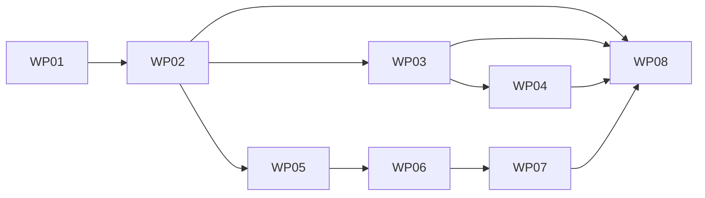

# Tasks: troupe configuration: load, show, set

**Mission**: `troupe-config-load-show-set-01M3XGPG` · **Spec**: [spec.md](spec.md) · **Plan**: [plan.md](plan.md)
**Planning/merge branch**: `feat/troupe-config-load-show-set` (delivered to `main` by local merge after acceptance)

Tests are required for every behaviour (charter TROUPE-005, NFR-001); every WP ships its own tests and
must pass `uv run pytest`, `uv run mypy --strict`, `uv run ruff check`, `uv run ruff format --check`.

## Subtask Index

| ID | Description | WP | Parallel |
|----|-------------|----|----------|
| T001 | uv project: pyproject, deps, console script, tool config, lock | WP01 | |
| T002 | Error hierarchy with exit codes (`errors.py`) | WP01 | [P] |
| T003 | Theatre/root-file discovery (`theatre.py`) | WP01 | [P] |
| T004 | CLI parser, dispatch, stdout/stderr discipline (`cli.py`) | WP01 | |
| T005 | Test harness (`conftest.py`) + CLI basics tests | WP01 | |
| T006 | SourceTree node types and origins (`tree.py`) | WP02 | |
| T007 | `yamlcore` adapter (compose, core-schema scalars) + file reading (`yamlcore.py`, `loader.py`) | WP02 | |
| T008 | Include resolution: YAML/text, recursion, missing, cycle | WP02 | |
| T009 | Path parsing and lookup (`paths.py`) | WP02 | [P] |
| T010 | Loader/include/path tests | WP02 | |
| T011 | Leaf flattening and diff (`leaves.py`) | WP03 | [P] |
| T012 | Event-sourced `ConfigHistory` aggregate + SQLite app (`history.py`) | WP03 | |
| T013 | Session: load + import-on-first-command (`session.py`) | WP03 | |
| T014 | `history [PATH]` command (`commands/history.py`) | WP03 | |
| T015 | History tests (import, persistence, filter, confinement) | WP03 | |
| T016 | VALUE parsing, YAML 1.2 core (`values.py`) | WP04 | [P] |
| T017 | Scalar printing rules (`values.py`) | WP04 | |
| T018 | `show PATH` command (`commands/show.py`) | WP04 | |
| T019 | Show tests (US1) | WP04 | |
| T020 | Newline/encoding helpers + atomic write (`writeback/fileio.py`) | WP05 | [P] |
| T021 | Quoting representability and style choice (`writeback/scalars.py`) | WP05 | [P] |
| T022 | Scalar text rendering incl. minimal double-quote escaping | WP05 | |
| T023 | End-of-line comment detection and column rule (`writeback/comments.py`) | WP05 | [P] |
| T024 | Primitive unit tests | WP05 | |
| T025 | Literal block rendering and chomping (`writeback/blocks.py`) | WP06 | |
| T026 | Existing block scalar header parsing and replacement | WP06 | |
| T027 | Folded paragraph matching and greedy re-wrap | WP06 | |
| T028 | More-indented refusal; flow-context multi-line fallback | WP06 | |
| T029 | Block scalar unit tests | WP06 | |
| T030 | File indentation detection (`writeback/collections.py`) | WP07 | |
| T031 | Block collection end detection (trailing comments) | WP07 | |
| T032 | Render new block entries (keys, items, intermediate mappings, sibling quoting) | WP07 | |
| T033 | Flow collections: append on last entry's line; flow rendering | WP07 | |
| T034 | Kind-changing replacement (scalar ↔ collection) preserving key line | WP07 | |
| T035 | Collection unit tests | WP07 | |
| T036 | Placement resolution (`writeback/placement.py`) | WP08 | |
| T037 | `apply_set`: replacing existing values and text includes (`writeback/apply.py`) | WP08 | |
| T038 | `apply_set`: new keys, appends, collection values | WP08 | |
| T039 | `set PATH VALUE` command with events (`commands/set_value.py`) | WP08 | |
| T040 | Integration tests: existing values, quoting, comments, text includes, refusals | WP08 | |
| T041 | Integration tests: new entries, collections, block/folded scalars, history | WP08 | |
| T042 | Full gates + quickstart verification | WP08 | |

## Phase 1 — Foundation

### WP01 — Project skeleton, CLI and error model

- **Prompt**: [tasks/WP01-project-skeleton-cli.md](tasks/WP01-project-skeleton-cli.md)
- **Goal**: `uv run troupe config …` runs; exit-code/stderr discipline; root-file discovery (exit 4).
- **Priority**: P1 (blocks everything) · **Independent test**: usage errors exit 2, missing/duplicate root exits 4, stdout empty on failure.
- **Subtasks**:
  T001 uv project: pyproject, deps, console script, tool config, lock (WP01)
  T002 Error hierarchy with exit codes (WP01)
  T003 Theatre/root-file discovery (WP01)
  T004 CLI parser, dispatch, stdout/stderr discipline (WP01)
  T005 Test harness + CLI basics tests (WP01)
- **Dependencies**: none
- **Risks**: lazy command-module import so later WPs plug in without editing `cli.py`.
- **Estimated prompt size**: ~330 lines

## Phase 2 — Reading the configuration (US1) and history (US3)

### WP02 — Loading, includes and paths

- **Prompt**: [tasks/WP02-loader-includes-paths.md](tasks/WP02-loader-includes-paths.md)
- **Goal**: SourceTree with exact origins for every node, recursive includes, path lookup.
- **Priority**: P1 · **Independent test**: loader tests over fixture theatres.
- **Subtasks**:
  T006 SourceTree node types and origins (WP02)
  T007 `yamlcore` adapter + file reading and span-preserving compose (WP02)
  T008 Include resolution: YAML/text, recursion, missing, cycle (WP02)
  T009 Path parsing and lookup (WP02)
  T010 Loader/include/path tests (WP02)
- **Dependencies**: Depends on WP01
- **Estimated prompt size**: ~380 lines

### WP03 — Event-sourced history and import

- **Prompt**: [tasks/WP03-event-sourced-history.md](tasks/WP03-event-sourced-history.md)
- **Goal**: `ConfigHistory` aggregate in `.troupe/history.sqlite`; import on first command; `history [PATH]`.
- **Priority**: P2 (US3) but foundational for `show`/`set` import · **Independent test**: `history` on fresh and repeated runs.
- **Subtasks**:
  T011 Leaf flattening and diff (WP03)
  T012 Event-sourced aggregate + SQLite app (WP03)
  T013 Session: load + import-on-first-command (WP03)
  T014 `history [PATH]` command (WP03)
  T015 History tests (WP03)
- **Dependencies**: Depends on WP02
- **Estimated prompt size**: ~360 lines

### WP04 — VALUE parsing, scalar printing and `show`

- **Prompt**: [tasks/WP04-values-and-show.md](tasks/WP04-values-and-show.md)
- **Goal**: User Story 1 complete.
- **Priority**: P1 · **Independent test**: all US1 acceptance scenarios via CLI.
- **Subtasks**:
  T016 VALUE parsing, YAML 1.2 core (WP04)
  T017 Scalar printing rules (WP04)
  T018 `show PATH` command (WP04)
  T019 Show tests (WP04)
- **Dependencies**: Depends on WP02, WP03
- **Estimated prompt size**: ~260 lines

## Phase 3 — Byte-surgical write-back renderers (parallel with Phase 2)

### WP05 — Write-back primitives: files, scalars, comments

- **Prompt**: [tasks/WP05-writeback-primitives.md](tasks/WP05-writeback-primitives.md)
- **Goal**: pure, unit-tested helpers for atomic writes, quoting, escaping and comment columns.
- **Priority**: P1 · **Independent test**: unit tests only.
- **Subtasks**:
  T020 Newline/encoding helpers + atomic write (WP05)
  T021 Quoting representability and style choice (WP05)
  T022 Scalar text rendering incl. minimal double-quote escaping (WP05)
  T023 End-of-line comment detection and column rule (WP05)
  T024 Primitive unit tests (WP05)
- **Dependencies**: Depends on WP02 (uses `yamlcore` to check plain-scalar representability)
- **Parallel**: can run alongside WP03–WP04.
- **Estimated prompt size**: ~380 lines

### WP06 — Block scalars: literal and folded

- **Prompt**: [tasks/WP06-block-scalars.md](tasks/WP06-block-scalars.md)
- **Goal**: literal block rendering, chomping, folded paragraph-preserving re-wrap, refusal rule.
- **Priority**: P2 · **Independent test**: unit tests only.
- **Subtasks**:
  T025 Literal block rendering and chomping (WP06)
  T026 Existing block scalar header parsing and replacement (WP06)
  T027 Folded paragraph matching and greedy re-wrap (WP06)
  T028 More-indented refusal; flow-context multi-line fallback (WP06)
  T029 Block scalar unit tests (WP06)
- **Dependencies**: Depends on WP05
- **Estimated prompt size**: ~380 lines

### WP07 — New entries and collection rendering

- **Prompt**: [tasks/WP07-collections-and-new-entries.md](tasks/WP07-collections-and-new-entries.md)
- **Goal**: insertion points below trailing comments, block/flow rendering, kind-changing replacement.
- **Priority**: P1 · **Independent test**: unit tests only.
- **Subtasks**:
  T030 File indentation detection (WP07)
  T031 Block collection end detection (WP07)
  T032 Render new block entries (WP07)
  T033 Flow collections (WP07)
  T034 Kind-changing replacement preserving key line (WP07)
  T035 Collection unit tests (WP07)
- **Dependencies**: Depends on WP05, WP06
- **Estimated prompt size**: ~430 lines

## Phase 4 — `set` end to end (US2)

### WP08 — `set PATH VALUE` integration

- **Prompt**: [tasks/WP08-set-command-integration.md](tasks/WP08-set-command-integration.md)
- **Goal**: User Story 2 complete; `set` emits history events; byte-exact integration suite.
- **Priority**: P1 · **Independent test**: all US2/US3 set scenarios with whole-file byte assertions.
- **Subtasks**:
  T036 Placement resolution (WP08)
  T037 `apply_set`: replacing existing values and text includes (WP08)
  T038 `apply_set`: new keys, appends, collection values (WP08)
  T039 `set PATH VALUE` command with events (WP08)
  T040 Integration tests: existing values, quoting, comments, text includes, refusals (WP08)
  T041 Integration tests: new entries, collections, block/folded scalars, history (WP08)
  T042 Full gates + quickstart verification (WP08)
- **Dependencies**: Depends on WP02, WP03, WP04, WP05, WP06, WP07
- **Estimated prompt size**: ~480 lines

## Dependency graph

MVP: WP01 → WP02 → WP03 → WP04 gives a working `show` + `history`.
