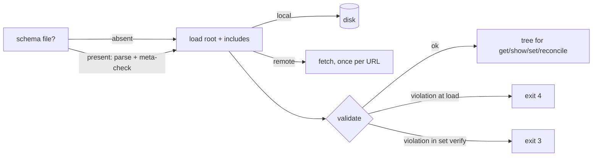

# Data Model: remote includes and a schema

Changes to the in-memory model only. The history event schema and the on-disk files under `.troupe/` other than the new optional schema file are unchanged.

## Types

| Type | Module | Fields / meaning | Invariants |
|---|---|---|---|
| `Url` (new) | `tree.py` | `text: str`, the absolute URL (`https://…` or `http://…`) as written, or resolved with `urljoin` (S-1) | frozen; equality is by text |
| `Location` (new alias) | `tree.py` | `Path \| Url` | a `Path` is absolute and resolved |
| `SourceFile` (changed) | `tree.py` | `location: Location` (was `path: Path`), `text: str`; property `remote` | one object per location per load; a remote `SourceFile` is never in a `WritePlan` |
| `RawTag` (new) | `yamlcore.py` | span of the `!literal` token and its trailing whitespace | only on `RawScalar`, only in file mode |
| `RawScalar` (changed) | `yamlcore.py` | `+ tag: RawTag \| None`; `start` is the content start (after any tag and anchor) | |
| `ScalarNode` (changed) | `tree.py` | `+ literal: Origin \| None`, the span of the `!literal` tag | `value` is a `str` when `literal` is set |
| `YamlInclude` / `TextInclude` (unchanged shape) | `tree.py` | `target: SourceFile`, which may now be remote | an include whose `origin.file` is remote has a remote target (S-1) |
| `Schema` (new) | `schema.py` | `location: Path`, `document: dict`, validator | the schema has passed the 2020-12 meta-schema check; every `$ref`/`$dynamicRef` is a `#` fragment |
| `Violation` (new) | `schema.py` | `path: str` (dotted or `(root)`), `message: str` | the first violation in JSON-path order |
| `Loaded` (new) | `configuration.py` | `tree: Node`, `schema: Schema \| None`, `fetched: dict[Url, str]` | `tree` validates against `schema` |
| `LiteralStr` (new) | `includes.py` | a `str` subclass marking a VALUE string to be written `!literal` | only created by `mark_literals` |
| `FetchError` (new) | `errors.py` | a `LoadError` (exit 4) | its message names the URL; the loader adds the including file and the path |

## Decision functions (one place each)

| Function | Module | Decides |
|---|---|---|
| `include_kind(text)` | `includes.py` | `file` / `remote` / none, by prefix |
| `resolve_target(text, containing)` | `includes.py` | the target `Location` (S-1) |
| `is_yaml_target(location)` | `includes.py` | YAML vs text by suffix of the path, or of the URL path (S-2) |
| `is_literal(text, tagged, uri)` | `includes.py` | literal vs include (S-7, S-10) |
| `mark_literals(value, segments, schema, include)` | `includes.py` | which VALUE strings are written `!literal`, and the `--include` + `uri` refusal (S-11, S-12) |
| `fetch(url)` | `remote.py` | the only network access (S-2) |
| `Schema.uri_at(segments, kinds)` | `schema.py` | the schema `format: uri` lookup (S-7) |
| `Schema.validate(tree)` | `schema.py` | validity (S-8) |
| `load_configuration(...)` | `configuration.py` | "loaded and valid" (S-8, S-9) |
| `remote_refusal(found, dotted)` | `writeback/placement.py` | read-only refusal and its message (S-4) |

## State and lifecycle

A load reads the schema first, because literal decisions depend on it. It then reads the root file and resolves includes depth first: local files from disk, remote documents through `fetch`, at most once per URL. Finally it validates. Within one command the `fetched` map is reused by every in-memory reload. Nothing remote is cached between commands.

## Invariants checked by tests

1. No `WritePlan` holds a remote `SourceFile`. `write_files` asserts it, and `set` scenarios in remote content refuse with exit 3 (S-4).
2. A literal string never becomes a `YamlInclude`/`TextInclude`, and the test server logs no request for it (S-7, S-10).
3. Every successful `set` leaves a configuration that validates (S-9).
4. An existing `!literal` tag survives replacement by a string value. It is removed when the value is replaced by a non-string (S-11).
