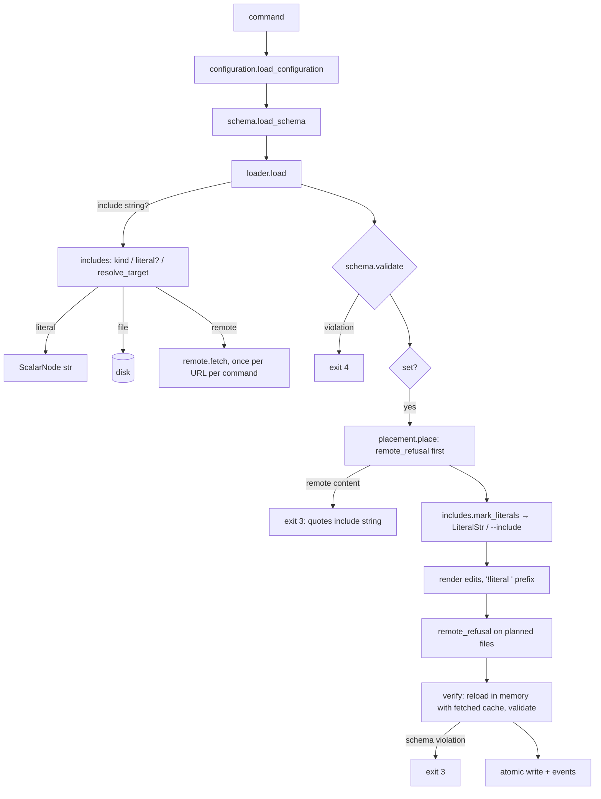

# Implementation Plan: troupe configuration: remote includes and a schema

**Branch**: `feat/troupe-config-remote-includes` (delivered to `main` by local merge) | **Date**: 2026-10-07 | **Spec**: [spec.md](spec.md)
**Input**: Feature specification from `kitty-specs/troupe-config-remote-includes-01M4BMJ5/spec.md` (step 7: contract section *Remote includes and schema*)

## Summary

- **One rule for includes and literals.** A new module, `troupe/includes.py`, holds the include rule. Today that test is copied in three places in `loader.py`. The module decides:
  - what an include string is (`file:`, `https://`, `http://`);
  - where it points: `file:` resolves against the containing file or URL (S-1);
  - whether it is YAML or text;
  - whether a string is a literal instead (`!literal`, or the schema marks its path `format: uri`).
- **Fetching.** A source location (`SourceFile.path`) becomes `Path | Url`. Remote documents are fetched by `troupe/remote.py`, which uses only the standard library: a 10 s total deadline, redirects to http(s) only, verified TLS, strict UTF-8 (S-2). Each URL is fetched once per command and reused by every reload during that command.
- **Schema.** `troupe/schema.py` loads and checks `.troupe/troupe.schema.json` and does the S-7 `format: uri` lookup. It validates the resolved configuration with `jsonschema`'s 2020-12 validator, the one new dependency (DM 01M4BMXJXSNEY2QMXYA1W16W04). `troupe/configuration.py` is the single "load and validate" entry point:
  - a failure at load exits 4;
  - a failure in a `set`'s in-memory verification exits 3.
- **`!literal` support.**
  - The composer accepts `!literal` on scalars and starts their span at the content, so writers keep the tag.
  - `set` marks include-looking VALUE strings with a `LiteralStr` marker, and the scalar renderers write `!literal ` in front of them.
  - `--include` turns the marking off.
- **Read-only remote content.** One guard in `writeback/placement.py` refuses any change to remote content and quotes the outermost include string exactly as written. It runs right after the path walk and again on the planned files. `write_files` also asserts that every target is local.

## Engineering Alignment

The product owner directed on 2026-10-07: "The brief doesn't cover this. Make the safest assumption …, record it as a decision with your reason, and carry on." That answered the only open planning question (the validator dependency, DM 01M4BMXJXSNEY2QMXYA1W16W04). All other design decisions are implementation choices made inside the confirmed spec (S-1 to S-13) and are recorded as R-1 to R-13 in [research.md](research.md). How they map to the spec:

1. **Source locations** (R-1). `SourceFile.path: Path | Url` (`Url` in the new `location.py`). The type change lets mypy find every disk-only use.
2. **Fetching** (R-2). `remote.fetch` is the only network access. Each failure is a `FetchError` (exit 4) naming the URL, the including file and the path.
3. **Include rule** (R-3). `includes.py` covers S-1, S-2 and S-3. Cycle detection works on resolved locations.
4. **`!literal`** (R-4, R-5). Tag spans are recorded in the composer. `ScalarNode.literal` holds the tag span. `$ref` values are always includes. Other tags still exit 4, and every tag in VALUE still exits 2.
5. **Schema** (R-6, R-10). The schema is loaded before the tree, because literal decisions depend on it. The schema file is checked against the meta-schema, and every `$ref` must point inside the file. `format` is not asserted. The first violation by path names the error.
6. **Read-only** (R-7). One message builder, two checkpoints, and an assertion in `write_files`.
7. **Writing literals** (R-8, R-9). The `LiteralStr` marker is applied per resulting path. An existing tag is kept when the new value is a string. The no-op check tells an include apart from a literal.
8. **Sources, watch and CLI** (R-11, R-12). `show --sources` prints URLs. `watch` ignores URLs and also watches the schema file. `set --include` is added.



## Technical Context

**Language/Version**: Python 3.12+ managed with uv; package `troupe`, console script `troupe = troupe.cli:main` (unchanged)
**Primary Dependencies**: `ruamel.yaml` 0.19.x (only through `troupe.yamlcore`) and `eventsourcing` 9.5.x, both unchanged. **New**: `jsonschema>=4.26,<5`, which brings `referencing`, `jsonschema-specifications`, `attrs` and `rpds-py`. Supply-chain review and the adversarial pass are in research.md; `[tool.uv] no-build-package = ["rpds-py"]` stops uv from building it from source. Network access uses `urllib.request` from the standard library.
**Storage**: user files `<theatre>/.troupe/troupe.yml` and local include targets (byte-surgical, atomic temp file + rename). The optional `<theatre>/.troupe/troupe.schema.json` is read-only. Remote content is never written. History stays in the `<theatre>/.troupe/` event store with the schema unchanged.
**Testing**: pytest. Black-box CLI tests run in subprocesses on real temporary theatres, with byte snapshots of every file. A real local HTTP server in a thread (`tests/remote_server.py`, `remote` fixture) logs every request, so tests can assert what was fetched, how often and with which method. TLS is tested with an `openssl`-generated self-signed certificate; that test is skipped with a reason if `openssl` is missing. Unit tests cover the composer tag spans, `includes`, `schema.uri_at`/`validate`, `remote.fetch` and `mark_literals`. Gates: `uv run pytest`, `uv run mypy --strict`, `uv run ruff check`, `uv run ruff format --check`.
**Target Platform**: macOS and Linux CLI
**Project Type**: single
**Performance Goals**: none (TROUPE-004). The only bound is the 10 s total fetch deadline (NFR-004).
**Constraints**:
- contract as written (C-001);
- untouched bytes stay identical (TROUPE-001, NFR-003);
- refusals change nothing (NFR-002);
- remote content is never written (NFR-001);
- writes are atomic (C-005);
- tests run offline (C-006).
**Scale/Scope**: 5 modules added (`location.py`, `includes.py`, `remote.py`, `schema.py`, `configuration.py`); about 14 modules changed; about 8 test files added and a few updated.

## Charter Check

| Directive / gate | Status | How |
|---|---|---|
| TROUPE-001 byte-preserving user files | Pass | New writes are the step 1–6 writes plus a `!literal ` prefix. Tag spans are kept (R-4, R-8). Local overrides under remote includes use the step-5 conversion unchanged. Tests snapshot every file. |
| TROUPE-002 conservative under uncertainty | Pass | Any remote write → exit 3, guarded twice plus an assertion (R-7). Failed or unverifiable fetches → exit 4. `--include` on a `uri` path → exit 3. Unresolvable schema references → exit 4. The validator dependency was chosen as the safest option (DM 01M4BMXJ…). |
| TROUPE-003 errors name path/file | Pass | Fetch errors name the URL, the including file and the path. Remote refusals name PATH, the include string and the local file and line. Schema errors name the schema file and path (contracts/cli.md). |
| TROUPE-004 fixed tech | Pass | Python 3.12/uv. One dependency added (Python, PyPI, locked with hashes). |
| TROUPE-005 tests that prove something | Pass | Real CLI, real files, real HTTP server with a request log, real event store. Every S-n choice has a test. |
| TROUPE-006 done means verified | Pass (at delivery) | All four gates run and their output shown. |
| TROUPE-007 one decision, one place | Pass | Include rule in `includes.py`, network in `remote.py`, schema in `schema.py`, load-and-validate in `configuration.py`, read-only decision in `placement.remote_refusal`, tag rendering in `scalars.render_scalar` and the block renderers. |
| TROUPE-008 whole scope, no invention | Pass | The whole section is in scope. Out-of-contract choices are S-1 to S-12, confirmed by the product owner as agent choices. A size limit on remote bodies was deliberately not invented (research A-1). |
| TROUPE-009 spec/code/tests together | Pass | `contracts/cli.md` records the delivered contract. The step-1 test changed by S-13 is updated in the same change as the code. |

Re-check after design: no violations. Complexity Tracking is not needed.

## Project Structure

### Documentation (this mission)

```
kitty-specs/troupe-config-remote-includes-01M4BMJ5/
├── spec.md
├── plan.md            # this file
├── research.md        # R-1…R-13, supply-chain review, adversarial pass
├── data-model.md      # Url/Location, SourceFile, RawTag, ScalarNode.literal, Schema, Loaded, LiteralStr
├── quickstart.md      # manual walkthrough with a local server
├── contracts/cli.md   # section as delivered, exit codes and messages
├── checklists/requirements.md
└── decisions/
```

### Source Code (repository root)

```
pyproject.toml / uv.lock     # + jsonschema>=4.26,<5; [tool.uv] no-build-package = ["rpds-py"]
src/troupe/
├── location.py              # NEW: Url, Location = Path | Url
├── includes.py              # NEW: include_kind, resolve_target, is_yaml_target, reads_as_include, path_steps, LiteralStr, mark_literals
├── remote.py                # NEW: fetch(url) — deadline, redirects, TLS, UTF-8; FetchError
├── schema.py                # NEW: load_schema, Schema.uri_at, Schema.validate, Violation
├── configuration.py         # NEW: load_configuration(theatre, overrides, fetched) -> Loaded
├── errors.py                # + FetchError(LoadError)
├── tree.py                  # SourceFile.path: Location; ScalarNode.literal
├── yamlcore.py              # RawTag; '!literal' on scalars in file mode; content-start spans after tags
├── loader.py                # uses includes.*; remote targets via fetch (+ fetched cache); schema-driven literals; $ref rules
├── session.py               # load via configuration.load_configuration; exposes schema + fetched
├── reconcile.py             # watched_files skips remote sources
├── commands/watch.py        # baseline adds troupe.schema.json; loads via configuration
├── commands/show.py, yamlout.py   # Line.source: Location; source_label prints URLs verbatim
├── commands/set_value.py    # --include passed; write-failure message (location prints as path or URL)
├── cli.py                   # set --include
├── writeback/placement.py   # remote_refusal (checkpoint 1)
├── writeback/apply.py       # mark_literals, checkpoint 2, _matches include vs literal, _verify via configuration (exit 3 on schema / new-include failure), fetched cache
├── writeback/scalars.py     # render_scalar: '!literal ' for LiteralStr
├── writeback/blocks.py      # '!literal ' before block indicators; remove tag on non-string replacement
├── writeback/collections.py # tag removal when a tagged scalar becomes a collection
└── writeback/fileio.py      # assert local Path

tests/
├── remote_server.py                          # NEW: threaded HTTP server, routes, request log, hang/trickle
├── conftest.py                               # + remote fixture, https fixture (openssl, skip with reason)
├── unit/test_includes.py                     # NEW: kind, resolve_target (urljoin), yaml target by URL path, reads_as_include, mark_literals
├── unit/test_remote_fetch.py                 # NEW: status, deadline, redirect scheme, UTF-8, BOM
├── unit/test_schema.py                       # NEW: load checks, uri_at walk, validate first violation
├── unit/test_yamlcore.py                     # + !literal spans, tag order with anchors, refusals
├── integration/test_remote_read.py           # NEW: US1 (get/show/--sources/history, nested, failures, cycle)
├── integration/test_remote_readonly.py       # NEW: US2 + US3 (refusals with include string, overrides)
├── integration/test_literals.py              # NEW: US4 (schema uri, !literal, nothing fetched)
├── integration/test_schema_validation.py     # NEW: US5 (load exit 4, set exit 3, format not asserted)
├── integration/test_set_literal.py           # NEW: US6 (!literal writes, --include, tag kept, exit 2 elsewhere)
├── integration/test_watch_schema.py          # NEW: watch reconciles on schema change; ignores URLs
└── integration/test_set_existing.py          # S-13: include-creating tests now pass --include
```

**Structure Decision**: single project, as in steps 1–6. The four new modules each own exactly one decision named in the Charter Check (TROUPE-007).

## Implementation Concern Map

> Concerns, not work packages.

| ID | Concern | Spec | Notes |
|---|---|---|---|
| IC-01 | Locations and fetching | FR-001, FR-003, S-2, NFR-004 | `location.Url/Location`, `SourceFile.path` retype (mypy-driven), `remote.py`, `FetchError`, `fileio` assertion, `yamlout`/`reconcile`/`watch` location handling. |
| IC-02 | Include rule and remote loading | FR-001, FR-002, S-1, S-3 | `includes.py` (kind, resolve, YAML/text), loader using it for scalar and `$ref` forms, URL cycles, fetched cache. |
| IC-03 | `!literal` in the composer and tree | FR-008, S-10 | `yamlcore` `RawTag` and spans, `ScalarNode.literal`, other tags and collection tags refused, `$ref` + `!literal` refused. |
| IC-04 | Schema load, literal lookup, validation | FR-007, FR-009, S-7, S-8 | `schema.py`, `configuration.py`, `jsonschema` dependency and lock, session/watch use, schema in watch baseline. |
| IC-05 | Read-only remote content | FR-004, FR-005, FR-006, S-4, S-5, S-6, NFR-001 | `placement.remote_refusal`, checkpoint 2 in `apply`, overrides under remote includes, `show --sources` URLs. |
| IC-06 | Writing literals and `--include` | FR-010, FR-011, FR-012, S-9, S-11, S-12, S-13 | `mark_literals`, renderers, tag keep/remove, `_matches`, `_verify` exit-3 causes, CLI flag, step-1 test update. |
| IC-07 | Test harness and docs | NFR-002, NFR-003, NFR-005, C-001, C-003, C-006 | `remote_server.py`, fixtures, module docstrings, `contracts/cli.md`. |

Dependencies: IC-07 (harness) and IC-01 → IC-02. IC-03 → IC-02 (literal strings are not includes). IC-04 → IC-02, IC-06. IC-05 → IC-02. IC-06 → IC-03, IC-04.

## Risks

- **`SourceFile.path` retype.** The change reaches several modules. Mitigation: mypy strict lists every site; the step 1–6 suite must pass unchanged apart from the S-13 test.
- **Tag spans.** Moving tagged scalars' `start` could shift writers. Mitigation: R-4 mirrors the step-6 anchor treatment. Unit tests pin spans for tag/anchor orders and all scalar styles, including block scalars.
- **Order of refusals.** Remote content reached through an alias must report the remote include rather than `--expand-alias`. Mitigation: `remote_refusal` runs before alias routing, with explicit tests.
- **Slow tests.** The deadline and trickle tests take about 10 s each. They are accepted and kept to two tests.
- **Large remote bodies** are not limited (research A-1, deferred with rationale).
- **Dependency freshness.** `rpds-py` was released days before planning. The locked versions are recorded at implementation and building from source is disabled.

## Complexity Tracking

None.
