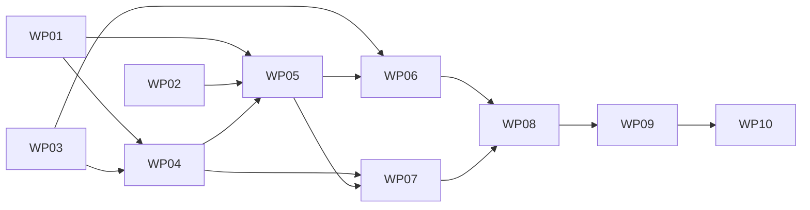

# Tasks: troupe configuration: remote includes and a schema

**Mission**: `troupe-config-remote-includes-01M4BMJ5` · **Spec**: [spec.md](spec.md) · **Plan**: [plan.md](plan.md) · **Research**: [research.md](research.md) · **Data model**: [data-model.md](data-model.md) · **Contract**: [contracts/cli.md](contracts/cli.md) · **Quickstart**: [quickstart.md](quickstart.md)
**Planning/merge branch**: `feat/troupe-config-remote-includes` (delivered to `main` by local merge after acceptance)
**Feature issue**: `bakeoff-specs-speckitty-1j5`

Rules for every WP:
- **Tests** (TROUPE-005): every WP ships tests for every behaviour it adds or changes. Tests run against real files, the real CLI, a real local HTTP server and the real event store. Test names state what the test proves.
- **Gates** (TROUPE-006): before review, each WP must pass `uv run pytest`, `uv run mypy --strict`, `uv run ruff check` and `uv run ruff format --check`. No WP may leave the suite red.
- **IDs**: S-1 to S-13 are the out-of-contract choices in spec.md. R-n are research decisions.
- **Ownership**: each WP edits only its `owned_files`. The one exception is a small, type-only edit forced by another WP's type change; record it with a one-line rationale in the Activity Log.

## Subtask Index

| ID | Description | WP | Parallel |
|----|-------------|----|----------|
| T001 | `location.py`: `Url`, `Location` | WP01 | |
| T002 | `errors.FetchError`; `remote.fetch` (deadline, redirects, TLS, status, UTF-8) | WP01 | |
| T003 | Test HTTP server `tests/remote_server.py` (routes, request log, hang, trickle, redirect) | WP01 | [P] |
| T004 | Fixtures `remote`, `https_remote` (openssl), hermetic `NO_PROXY` in `run_cli` | WP01 | |
| T005 | Unit tests `tests/unit/test_remote_fetch.py` | WP01 | |
| T006 | `yamlcore`: `RawTag` on `RawScalar`; content start after tag and anchor | WP02 | |
| T007 | `yamlcore`: file-mode tag rules (`!literal` on scalars only; others unchanged) | WP02 | |
| T008 | Unit tests: tag spans for every scalar style, refusals, VALUE mode unchanged | WP02 | |
| T009 | Docstrings; check other `compose` callers | WP02 | |
| T010 | Add `jsonschema` dependency, `no-build-package`, lock; record versions | WP03 | |
| T011 | `schema.load_schema` checks (JSON, `$schema`, meta-schema, fragment refs) | WP03 | |
| T012 | `Schema.uri_at` walk (S-7) | WP03 | [P] |
| T013 | `Schema.validate` → first `Violation` | WP03 | [P] |
| T014 | Unit tests `tests/unit/test_schema.py` | WP03 | |
| T015 | `includes`: `include_kind`, `resolve_target`, `is_yaml_target` | WP04 | |
| T016 | `includes.reads_as_include`, `path_steps` | WP04 | |
| T017 | `includes.LiteralStr`, `IncludeStr`, `mark_literals` (+ `--include` / `uri` refusal) | WP04 | |
| T018 | Unit tests `tests/unit/test_includes.py` | WP04 | |
| T019 | `tree.SourceFile.path: Location`, `remote`, `ScalarNode.literal`; `fileio`/`yamlout`/`reconcile` for URLs | WP05 | |
| T020 | Loader: include resolution through `includes`, remote targets, `fetched` cache, URL cycles, fetch context | WP05 | |
| T021 | Loader: literal decisions (tag, schema `uri` with kinds), path-aware C3, `$ref` rules | WP05 | |
| T022 | Unit tests `tests/unit/test_loader_remote.py` | WP05 | |
| T023 | Unit tests `tests/unit/test_loader_literals.py` + `yamlout`/`reconcile`/`fileio` cases | WP05 | |
| T024 | `configuration.load_configuration` (schema → load → validate) | WP06 | |
| T025 | `session` and `watch` use it; schema file in watch baseline | WP06 | |
| T026 | Integration US1 `tests/integration/test_remote_read.py` | WP06 | [P] |
| T027 | Integration US4 `tests/integration/test_literals.py` | WP06 | [P] |
| T028 | Integration US5 (load part) `tests/integration/test_schema_validation.py` | WP06 | [P] |
| T029 | Integration `tests/integration/test_watch_schema.py` | WP06 | |
| T030 | `scalars.render_scalar`: `!literal ` before a `LiteralStr` | WP07 | |
| T031 | `blocks`: `!literal ` before block indicators | WP07 | |
| T032 | `collections`: tag removal when a tagged scalar becomes a collection; `LiteralStr` in flow/new-key/override renderers | WP07 | |
| T033 | Unit tests `tests/unit/test_literal_rendering.py` | WP07 | |
| T034 | `placement.remote_refusal`, checkpoint 1 before alias routing | WP08 | |
| T035 | `apply`: checkpoint 2 on planned files | WP08 | |
| T036 | `apply`: `SetContext`; reloads with `fetched` and schema; exit-3 causes (S-9, S-12) | WP08 | |
| T037 | `apply`: `mark_literals`, `_matches` include vs literal, text includes untagged; `cli --include`; `set_value` wiring | WP08 | |
| T038 | `apply`: tag keep/insert/remove edits on scalar replacement | WP08 | |
| T039 | Unit tests `tests/unit/test_placement_remote.py` | WP08 | |
| T040 | Integration US2/US3 `tests/integration/test_remote_readonly.py` | WP08 | [P] |
| T041 | Integration US5-3 and literal mechanics `tests/integration/test_set_schema.py`; S-13 updates in `test_set_existing.py` | WP08 | [P] |
| T042 | Integration US6 `tests/integration/test_set_literal.py` | WP09 | [P] |
| T043 | Integration `--include` with remote targets `tests/integration/test_set_include_remote.py` | WP09 | [P] |
| T044 | S-13 sweep of the existing suite | WP09 | |
| T045 | Acceptance `tests/integration/test_remote_acceptance.py`: NFR-001/002/003, edge cases, history and lineage | WP10 | |
| T046 | Quickstart walk-through; spec/contract/code agreement; docstrings | WP10 | |
| T047 | Full gates; follow-up beads | WP10 | |

## Phase 1 — Foundations (parallel)

### WP01 — Locations, fetching and the HTTP test harness

- **Prompt**: [tasks/WP01-locations-fetch-harness.md](tasks/WP01-locations-fetch-harness.md)
- **Goal**:
  - `Url`/`Location` types.
  - `remote.fetch`, the only network access, with a 10 s total deadline, http(s)-only redirects, verified TLS, 2xx only and strict UTF-8.
  - A threaded local HTTP server for tests, with a request log.
- **Priority**: P1 (foundation)
- **Independent test**: unit tests drive `fetch` against the local server for every success and failure case.
- **Subtasks**: T001 types; T002 fetch + `FetchError`; T003 server; T004 fixtures; T005 unit tests.
- **Dependencies**: none
- **Estimated prompt size**: ~220 lines

### WP02 — `!literal` in the composer

- **Prompt**: [tasks/WP02-literal-tag-composer.md](tasks/WP02-literal-tag-composer.md)
- **Goal**:
  - In file mode, `yamlcore.compose` accepts `!literal` on scalars and records the tag span. The scalar span starts at the content (R-4).
  - `!literal` on a collection is refused. Other tags keep their message. VALUE mode is unchanged.
- **Priority**: P1 (foundation)
- **Independent test**: composer unit tests; the whole suite stays green.
- **Subtasks**: T006 `RawTag` + spans; T007 rules; T008 tests; T009 docstrings and callers.
- **Dependencies**: none
- **Estimated prompt size**: ~160 lines

### WP03 — Schema module and the `jsonschema` dependency

- **Prompt**: [tasks/WP03-schema-module.md](tasks/WP03-schema-module.md)
- **Goal**: `schema.py` provides:
  - `load_schema`: the S-8 checks;
  - `Schema.uri_at`: the S-7 walk;
  - `Schema.validate`: 2020-12, `format` not asserted, first violation by path.

  Adds the dependency safely: locked, wheels only for `rpds-py`.
- **Priority**: P1 (foundation)
- **Independent test**: unit tests on schema files written to `tmp_path`.
- **Subtasks**: T010 dependency; T011 load; T012 `uri_at`; T013 validate; T014 tests.
- **Dependencies**: none
- **Estimated prompt size**: ~185 lines

## Phase 2 — Loading

### WP04 — The include rule in one module

- **Prompt**: [tasks/WP04-include-rule-module.md](tasks/WP04-include-rule-module.md)
- **Goal**: `includes.py` holds:
  - what an include string is;
  - where it points, including `file:` against a URL (S-1);
  - YAML or text, by URL path (S-2);
  - literal or include (S-7, S-10);
  - which VALUE strings `set` writes `!literal`, and the `--include` + `uri` refusal (S-11, S-12).
- **Priority**: P1
- **Independent test**: pure unit tests.
- **Subtasks**: T015–T018.
- **Dependencies**: WP01, WP03
- **Estimated prompt size**: ~200 lines

### WP05 — Tree and loader: remote includes and literals

- **Prompt**: [tasks/WP05-tree-loader-remote-literals.md](tasks/WP05-tree-loader-remote-literals.md)
- **Goal**: `SourceFile.path` becomes `Location`. The loader then:
  - resolves `file:` and remote includes through `includes`, fetching once per URL per command;
  - builds literal strings for `!literal` and schema-`uri` strings;
  - refuses URL cycles, `!literal` on `$ref` values and anchors on remote include references.

  `show --sources` prints URLs, `watched_files` skips remote sources, and `write_files` asserts local paths.
- **Priority**: P1
- **Independent test**: loader unit tests against the local server and real files.
- **Subtasks**: T019–T023.
- **Dependencies**: WP01, WP02, WP04
- **Estimated prompt size**: ~205 lines

### WP06 — Load and validate: sessions, watch and the read stories

- **Prompt**: [tasks/WP06-configuration-sessions-watch.md](tasks/WP06-configuration-sessions-watch.md)
- **Goal**:
  - `configuration.load_configuration` is the one "loaded and valid" entry point; an invalid configuration exits 4.
  - Sessions and `watch` use it, and the schema file is watched.
  - US1, US4 and the load part of US5 pass end to end.
- **Priority**: P1
- **Independent test**: CLI subprocess tests with the local server.
- **Subtasks**: T024–T029.
- **Dependencies**: WP03, WP05
- **Estimated prompt size**: ~190 lines

## Phase 3 — Writing

### WP07 — Rendering `!literal`

- **Prompt**: [tasks/WP07-literal-rendering.md](tasks/WP07-literal-rendering.md)
- **Goal**:
  - Every renderer of a new string writes `!literal ` before a `LiteralStr`: single-line, block, flow, new key, override and list item.
  - A tagged scalar replaced by a collection loses its tag.
- **Priority**: P1
- **Independent test**: renderer unit tests; rendered text read back through the composer.
- **Subtasks**: T030–T033.
- **Dependencies**: WP04, WP05
- **Estimated prompt size**: ~150 lines

### WP08 — `set`: remote content is read-only, literals and `--include`, verification with the schema

- **Prompt**: [tasks/WP08-set-readonly-verify.md](tasks/WP08-set-readonly-verify.md)
- **Goal**: wire every step-7 write rule into `set`:
  - the remote refusal (S-4) at both checkpoints, quoting the include string as written;
  - verification reloads through the schema with the command's `fetched` cache: a schema violation exits 3 (S-9), and a new include that fails to load exits 3 (S-12);
  - `mark_literals`, and the no-op rule that tells an include from a literal (R-9);
  - tag edits on replacement (R-8);
  - `cli --include` and the `set_value` wiring;
  - the S-13 updates of step-1 tests.
- **Priority**: P1
- **Independent test**: placement unit tests; CLI tests with byte snapshots and the request log (US2, US3, US5-3).
- **Subtasks**: T034–T041.
- **Dependencies**: WP06, WP07
- **Estimated prompt size**: ~250 lines

### WP09 — `set --include` and literal writes: the US6 stories

- **Prompt**: [tasks/WP09-set-include-literal-writes.md](tasks/WP09-set-include-literal-writes.md)
- **Goal**: a black-box, byte-exact proof of US6 and of `--include` with remote targets, written independently of WP08's code. Also an S-13 sweep of the existing suite.
- **Priority**: P1
- **Independent test**: CLI tests with byte snapshots.
- **Subtasks**: T042–T044.
- **Dependencies**: WP08
- **Estimated prompt size**: ~120 lines

## Phase 4 — Acceptance

### WP10 — Acceptance, documentation sync and gates

- **Prompt**: [tasks/WP10-acceptance.md](tasks/WP10-acceptance.md)
- **Goal**:
  - Cross-cutting acceptance tests: NFR-001 to NFR-003, edge cases, history and lineage.
  - The quickstart walk-through.
  - Spec, contract and code agreement.
  - Full gates, and follow-up beads for anything left over.
- **Priority**: P2
- **Subtasks**: T045–T047.
- **Dependencies**: WP09
- **Estimated prompt size**: ~120 lines

## Dependency graph

**Parallel opportunities**:
- WP01, WP02 and WP03 can run in parallel.
- WP06 and WP07 can run in parallel after WP05.

**MVP**: WP01–WP06 deliver reading remote includes, literals and schema validation. WP07–WP08 add the write rules; WP09–WP10 prove them end to end.
