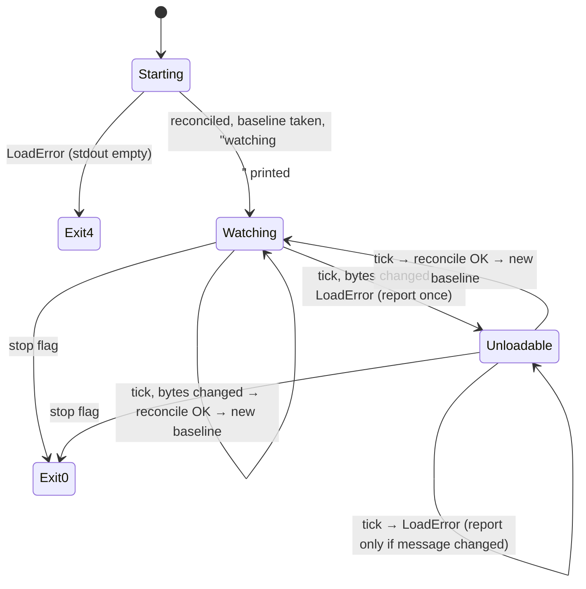

# Data Model: troupe configuration: sync with files

Step-1 entities (SourceTree nodes, `Change`, `HistoryRecord`, persisted events) are unchanged
unless noted.

## Recorded configuration (new view on the existing aggregate)

| Field | Type | Notes |
|---|---|---|
| `ConfigHistory.leaves` | `dict[str, JsonScalar]` | path → value; insertion order = first-recorded order |

Event → state transitions (applied on creation and on every replay):

| Event | Effect on `leaves` |
|---|---|
| `Created` | `leaves = {}` |
| `LeafImported(path, new)` | `leaves[path] = new` |
| `LeafSet(path, old, new)` | `leaves[path] = new` (adds the path if new) |
| `LeafRemoved(path, old)` | `del leaves[path]` |

**Invariant (after any reconcile, under the lock):** `leaves == flatten(load(files))`, compared with
`leaves.same` per path, with the same set of paths.

## Reconcile (function, `troupe/reconcile.py`)

```
reconcile(store, tree) -> list[Change]
    changes = diff(store.recorded_leaves(), flatten(tree))   # sets in file order, then removes
    store.record(changes)                                    # one atomic save; no-op for []
    return changes
```

- Never writes user files.
- Ordering decision D-6 lives in `leaves.diff` (unchanged).

## Watched files (function, `troupe/reconcile.py`)

`watched_files(tree) -> dict[Path, bytes]`: maps every `SourceFile` reachable from the tree to its
text encoded as UTF-8. That covers each node's origin file, `YamlInclude.target` and
`TextInclude.target`. These bytes are the baseline for `watch`.

## Watch session (state of `troupe/commands/watch.py`)

| Field | Type | Meaning |
|---|---|---|
| `baseline` | `dict[Path, bytes \| None] \| None` | watched files plus both root candidates (`None` = absent); `None` while unloadable |
| `last_error` | `str \| None` | last reported `LoadError` message |
| `stop` | `threading.Event` | set by SIGINT/SIGTERM |

State transitions:



## Theatre lock (`troupe/lock.py`)

`theatre_lock(state_dir)` is a context manager: exclusive, blocking `flock` on an `O_RDONLY` fd of
`state_dir`, released on exit. It is held for the whole of `open_session` (all commands) and for
each `watch` reconcile, never while `watch` sleeps.

## Session (`troupe/session.py`, changed signature)

`open_session(theatre_dir: Path, *, reconcile: bool) -> Iterator[Session]`

Order: lock → locate → load → open store → import if never imported, otherwise reconcile if
`reconcile` → yield → close store → unlock.

`Session` is unchanged apart from being produced under the lock: `tree` is the configuration the
reconcile compared against, so a command's own work starts from the reconciled state.
