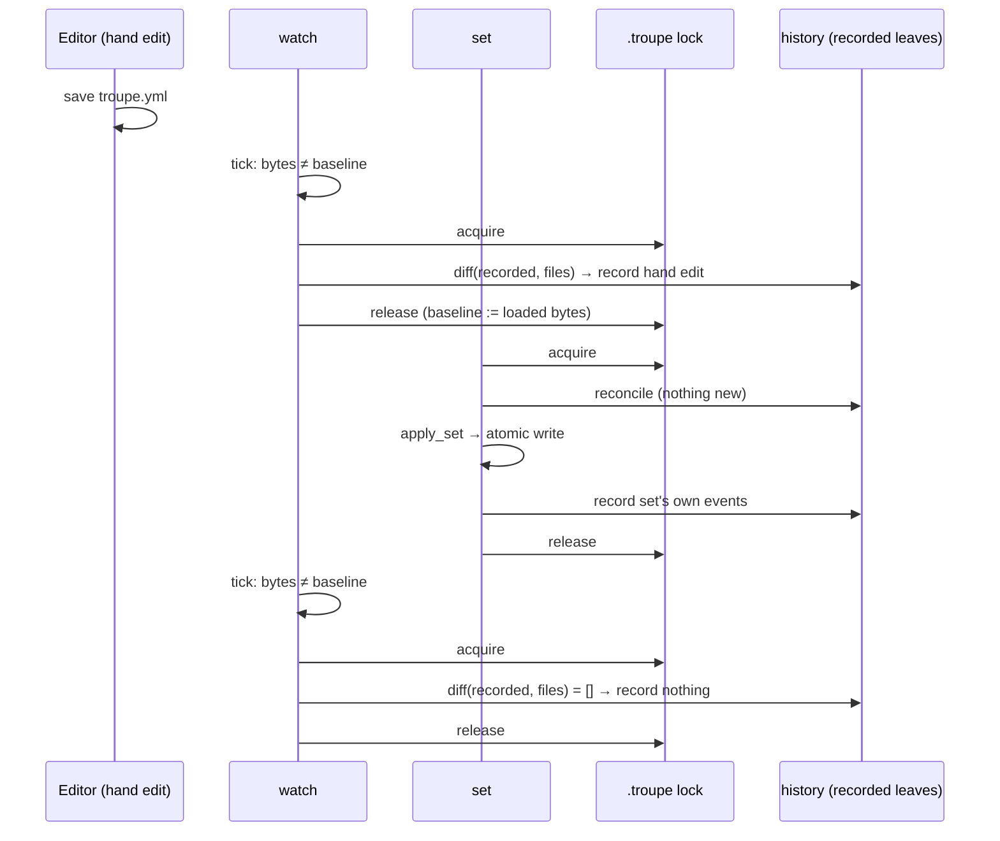

# Implementation Plan: troupe configuration: sync with files

**Branch**: `feat/troupe-config-sync-files` (delivered to `main` by local merge) | **Date**: 2026-10-03 | **Spec**: [spec.md](spec.md)
**Input**: Feature specification from `kitty-specs/troupe-config-sync-files-01M3ZT6R/spec.md`

## Summary

Add **reconcile** and `troupe config watch` on top of the step-1 subsystem.

- **Reconcile** loads the files, compares their leaves with the *recorded configuration*, and records `set`/`remove` events for the differences. The recorded configuration is a path→value map that the history aggregate maintains as events are replayed.
- `show` and `set` reconcile first. `history` never does.
- `watch` polls the bytes of the watched files and reconciles when they change.

A `set`'s write-back is never recorded twice. Every reconcile and every `set` (from its reconcile through writing files and recording events) runs under one exclusive theatre lock. A write-back is therefore already recorded before `watch` can look at it, so `watch`'s comparison finds nothing to record (decision DM-01M3ZTEW6H2NYB4NYVW9RB3PJ3, option A).

## Engineering Alignment (confirmed 2026-10-03)

1. **Write-back suppression and exactly-once recording.** An exclusive `flock` covers each session: load, import if needed, reconcile, then the command's own work.
   - The lock is taken on a file descriptor of the `<theatre>/.troupe` directory, so no new file is created (research R-02).
   - A reconcile records only differences from the recorded configuration (research R-01).
2. **How `watch` observes files.** Stdlib polling about every 250 ms, comparing the **bytes** of the watched files plus both root-file names against a baseline. The baseline is the exact text the last reconcile loaded. No new dependency (research R-03).
3. **Watched set.** The files the last successful load read: the root file, YAML includes and text-include targets, at any depth. It is recomputed on every reconcile.
4. **When the configuration is unloadable during `watch`.** `watch` retries reconcile on every tick. It prints one `troupe: …` stderr line naming the file when it becomes unloadable, and another only when the message changes (D-1, research R-05).
5. **Recorded configuration.** `ConfigHistory` keeps a `leaves` dict that the import, set and remove events update. Existing step-1 histories replay into it, and `history` output is unchanged (research R-04).
6. **One reconcile entry point**, used by `show`, `set` and `watch` through `open_session(..., reconcile=True)`. `history` uses `reconcile=False`: it imports a never-imported theatre but never reconciles.
7. **Signals.** SIGINT and SIGTERM set a stop flag. Any reconcile in progress completes (it is one atomic save), then `watch` exits 0 (research R-06).
8. **`watching <dir>`** echoes the directory as given (D-8 / FR-009).



## Technical Context

**Language/Version**: Python 3.12+ managed with uv; package `troupe`, console script `troupe = troupe.cli:main` (unchanged)
**Primary Dependencies**: unchanged: `eventsourcing` 9.5.x and `ruamel.yaml` 0.19.x. **No new dependencies.** File observation uses stdlib polling, the lock uses stdlib `fcntl.flock`, and signals use stdlib `signal` and `threading.Event`.
**Storage**: user YAML/text files (reconcile only reads them); `<theatre>/.troupe/history.sqlite` (unchanged schema; the aggregate gains in-memory `leaves` state rebuilt on replay); the lock is an advisory `flock` on the `.troupe` directory itself (no file)
**Testing**: pytest. Black-box tests run the real CLI as a subprocess: `watch` via `subprocess.Popen`, waiting for the readiness line under a timeout, editing files, then polling `history` until a deadline (2 s after the edit), and sending SIGINT/SIGTERM. Real files and the real eventsourcing SQLite store throughout; `mypy --strict`; `ruff check`; `ruff format --check`.
**Target Platform**: macOS and Linux CLI (`fcntl.flock` on a directory fd is supported on both)
**Project Type**: single
**Performance Goals**: no performance targets beyond the contracted 2-second reaction (NFR-001); poll interval of 0.25 s
**Constraints**: reconcile never writes user files (NFR-004); state only under `<theatre>/.troupe/`; stdout of `watch` is only the readiness line; every error names a path or file
**Scale/Scope**: small hand-edited configurations; at most one `watch` plus one other command at a time (C-003)

## Charter Check

*GATE: Must pass before Phase 0 research. Re-checked after Phase 1 design — still passing.*

| Charter rule | How the plan satisfies it | Status |
|---|---|---|
| TROUPE-001 byte-for-byte preservation | Reconcile and `watch` only read files; `set` write-back is unchanged; tests snapshot every file around reconcile/watch | Pass |
| TROUPE-002 conservative, data-safe | Lock serialises every history change; unloadable state records nothing and loses nothing (D-1); reconcile save is atomic; signal waits for an in-progress save | Pass |
| TROUPE-003 errors name path/file | Unloadable reports reuse `LoadError` messages, which name the file | Pass |
| TROUPE-004 fixed constraints | No new dependency; `eventsourcing` kept; macOS/Linux stdlib only | Pass |
| TROUPE-005 real tests | `watch` tested as a real subprocess with real signals and real files; no fake clocks or fake watchers | Pass |
| TROUPE-006 gates shown | pytest, mypy --strict, ruff check, ruff format --check per WP and at delivery | Pass |
| TROUPE-007 one decision, one place | Reconcile rule in `troupe/reconcile.py`; lock in `troupe/lock.py`; poll interval and change detection in `troupe/commands/watch.py`; recorded leaves in `history.py` | Pass |
| TROUPE-008/009 spec/code/tests agree | Step-1 tests encoding "hand edits never produce events" are updated in the same change as reconcile (IC-02) | Pass |
| DIRECTIVE_036 black-box testing | Acceptance suite drives the CLI | Pass |

Supply chain (directive 051, advisory): no dependency is added, upgraded or removed, so no adversarial-squad pass is needed (research R-08).

## Project Structure

### Documentation (this mission)

```
kitty-specs/troupe-config-sync-files-01M3ZT6R/
├── spec.md
├── plan.md              # this file
├── research.md          # Phase 0
├── data-model.md        # Phase 1
├── quickstart.md        # Phase 1
├── contracts/
│   └── cli-watch.md     # Phase 1: watch + reconcile-first CLI contract
├── checklists/requirements.md
└── decisions/
```

### Source Code (repository root)

```
src/troupe/
├── cli.py               # + watch subparser; long-running command protocol (announce/report callbacks)
├── session.py           # open_session(theatre_dir, reconcile=...) takes the lock, loads, imports, reconciles
├── lock.py              # NEW: theatre_lock(state_dir) — exclusive flock on the .troupe directory fd
├── reconcile.py         # NEW: reconcile rule: diff(recorded leaves, file leaves) → record; watched_files(tree)
├── history.py           # ConfigHistory gains `leaves` state; HistoryStore.recorded_leaves()
├── leaves.py            # unchanged (flatten, diff, same reused)
└── commands/
    ├── show.py          # reconcile=True
    ├── set_value.py     # reconcile=True; set's diff taken from the post-reconcile tree
    ├── history.py       # reconcile=False
    └── watch.py         # NEW: startup, poll loop, unloadable reporting, signal handling

tests/
├── integration/
│   ├── test_reconcile_first.py   # NEW: US1
│   ├── test_watch.py             # NEW: US2 (+ signals, startup errors)
│   ├── test_watch_set.py         # NEW: US3 (write-back not re-detected, near-simultaneous edits)
│   ├── test_watch_includes.py    # NEW: US4
│   ├── test_history.py           # updated: history never reconciles
│   └── test_set_history.py       # updated: hand edit recorded by set's reconcile before its own event
└── unit/
    ├── test_reconcile.py         # NEW: diff/ordering, no-op edits, watched_files
    └── test_history_store.py     # + recorded leaves after replay
```

**Structure Decision**: single project, extending the existing `src/troupe` package and the `tests/unit` + `tests/integration` split.

## Implementation Concern Map

> Concerns are not work packages; `/spec-kitty.tasks` decides the slicing.

### IC-01 — Recorded configuration and theatre lock

- **Purpose**: Give the history a queryable path→value view and serialise every history-changing session, which is the foundation of exactly-once recording.
- **Relevant requirements**: FR-001, FR-016, NFR-003
- **Affected surfaces**: `src/troupe/history.py`, `src/troupe/lock.py`, `src/troupe/session.py`, `tests/unit/test_history_store.py`
- **Sequencing/depends-on**: none
- **Risks**: replaying step-1 databases must give identical `history` output (regression test with a step-1-shaped store). The lock must not create files (`test_history.py:154`).

### IC-02 — Reconcile and reconcile-first commands

- **Purpose**: Implement the reconcile rule once and call it from `show` and `set`, while `history` stays reconcile-free.
- **Relevant requirements**: FR-002–FR-007, NFR-004
- **Affected surfaces**: `src/troupe/reconcile.py`, `src/troupe/session.py`, `src/troupe/commands/{show,set_value,history}.py`, updated step-1 tests (`tests/integration/test_set_history.py::test_set_after_hand_edit_records_the_hand_edited_value_as_old`, `tests/integration/test_history.py::test_hand_edit_after_import_produces_no_event`), new `tests/integration/test_reconcile_first.py`, `tests/unit/test_reconcile.py`
- **Sequencing/depends-on**: IC-01
- **Risks**: this deliberately changes step-1 behaviour, so the superseded tests must be rewritten, not deleted. Reconcile events are kept when the command then fails (D-7).

### IC-03 — `watch` command

- **Purpose**: A long-running command that prints the readiness promise, polls watched files, reconciles within 2 s, survives unloadable edits and exits 0 on signals.
- **Relevant requirements**: FR-008–FR-014, NFR-001, NFR-002, NFR-005, NFR-007
- **Affected surfaces**: `src/troupe/cli.py` (subparser, announce/report channel, theatre-as-given), `src/troupe/commands/watch.py`, `tests/integration/test_watch.py`, `tests/integration/test_watch_includes.py`
- **Sequencing/depends-on**: IC-02
- **Risks**: timing-sensitive tests. They wait on events with deadlines and never use bare sleeps as assertions, and they always terminate the child process in a `finally`. The readiness line must come after the baseline is taken. Changing the CLI's output discipline must keep stdout empty on every non-zero exit.

### IC-04 — Write-back non-detection under concurrency

- **Purpose**: Prove and guarantee that a `set` during `watch` records only its own events, and that near-simultaneous hand edits are recorded exactly once.
- **Relevant requirements**: FR-015, FR-016, NFR-003
- **Affected surfaces**: `src/troupe/commands/set_value.py` (whole set under the session lock), `tests/integration/test_watch_set.py`
- **Sequencing/depends-on**: IC-01, IC-03
- **Risks**: a hand edit landing *during* a `set`'s locked section is a concurrent writer to the same file, which is out of contract (C-003). It is documented, not handled.

## Complexity Tracking

No charter violations.
