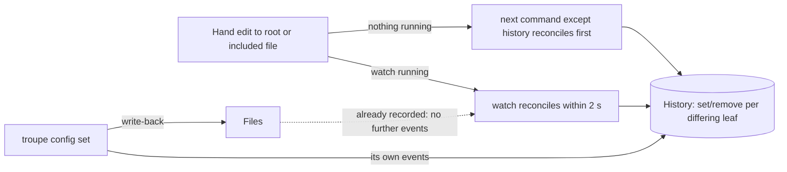

# Mission Specification: troupe configuration: sync with files

**Mission Branch**: `feat/troupe-config-sync-files` (delivered to `main`)
**Created**: 2026-10-03
**Status**: Draft
**Input**: Step 2 brief — keep files and configuration in sync. Adds `troupe config watch`; every command except `history` reconciles first; troupe's own write-backs are never picked up again as new changes. Contract section added: Sync with files. Builds on mission `troupe-config-load-show-set-01M3XGPG` (step 1), whose contract sections stay in force except where this spec says otherwise.

## Intent Summary (confirmed)

A theatre owner edits `.troupe/` files by hand in their editor, either while `troupe config watch` is running or while no troupe command is running at all. Every such edit that changes a leaf's value ends up in the configuration history as `set`/`remove` events. Edits picked up by `watch` are recorded within 2 seconds. Edits made while nothing was running are recorded by the next command other than `history`, before that command does anything else. Formatting-only and comment-only edits record nothing. When troupe itself writes a value back (a `set`), that write is recorded exactly once, by the `set`, and never a second time by `watch` or by a later reconcile.

**Rule that must always hold:** after any reconcile, the recorded configuration (the leaves obtained by replaying the history) equals the leaves of the files on disk, and each difference between them is recorded exactly once.

**Supersedes step 1:** the step-1 confirmed decision (DM 01M3XGPT4E0D67ZJY8PT7Z9NAT) and FR-008/FR-022 said that hand edits never produce history events. Step 2 replaces this. Hand edits are now recorded by reconcile. The files on disk are still the source of truth: reconcile only ever brings the history in line with the files and never changes a file.

**Decisions and choices recorded for this step:**

| # | Choice | Why | Source |
|---|--------|-----|--------|
| D-1 | If a hand edit makes the configuration unloadable while `watch` runs, `watch` keeps running. It writes one stderr line naming the offending file, records nothing, and reconciles normally once the files load again. | The contract says `watch` runs until SIGINT/SIGTERM and then exits 0, so exiting partway through would contradict it. Recording nothing while the files are unloadable cannot corrupt the history, and the next successful reconcile picks up every edit made in between, so nothing is lost (TROUPE-002). | DM 01M3ZT7G1XJ2P4KVP6JA8HHEEP (product owner: "make the safest assumption") |
| D-2 | `watch` writes nothing to stdout except the one `watching <dir>` line. | Out of contract (product owner: escalated answers, watch stdout); kept minimal. | Product owner, no objection |
| D-3 | On a never-imported theatre, `watch` imports first, as every command does. | "The first command run against a theatre imports it" (step-1 history). | Contract |
| D-4 | If the configuration cannot load when `watch` starts, it exits 4 with empty stdout and does not print `watching`. | General exit codes; "the line is a promise". | Contract |
| D-5 | `history` imports a never-imported theatre but never reconciles. | Stated in history and in Sync with files. | Contract |
| D-6 | Within one reconcile, `set` events come first in the files' document order, then `remove` events in the recorded configuration's order. This is the same ordering a `set` command uses. | The contract states no order; reusing the existing order keeps the decision in one place (TROUPE-007). | Product owner, accepted |
| D-7 | When a command reconciles first and then fails (exit 3 or 5), the reconcile's events are kept. | The reconcile events describe the files as they really are, whatever the command then does. This matches step 1, where an import is kept when the command that triggered it fails. | Choice where contract is silent |

## Domain Language

| Term | Meaning | Avoid |
|------|---------|-------|
| Recorded configuration | The leaves (path → value) obtained by replaying the theatre's history: import, then every `set` and `remove` in order | "projection" in user-facing text, "cache" |
| Reconcile | Compare the leaves of the files on disk with the recorded configuration, and record one `set` or `remove` event for each leaf that differs | "sync", "refresh", "import" |
| Import | The one-time recording of every leaf of a never-before-seen theatre (unchanged from step 1) | "reconcile" |
| Hand edit | A change to the root file or an included file made by anything other than a troupe command | "external change" |
| Write-back | The file change a `troupe config set` makes | |
| Watched files | The root file plus every file currently included from it, directly or transitively (YAML and text includes) | |

Leaf values are compared by type and value, exactly as in step 1. `0.2` and `0.20` are the same value, but `1`, `1.0`, `"1"` and `true` are all different.

## User Scenarios & Testing *(mandatory)*

### User Story 1 - Edits made while nothing was running are picked up (Priority: P1)

A theatre owner edits configuration files while no troupe command is running. The next command records those edits before doing its own work, so the history reflects what is in the files.

**Why this priority**: This is the simplest form of the sync guarantee. It needs no long-running process, and every other story relies on the reconcile it defines.

**Independent Test**: Import a fixture theatre, hand-edit the files (change a value, add a key, delete a key, edit an included file, make a comment-only edit), then run `show`, `set` or `history` and compare the JSON Lines output of `history` before and after.

**Acceptance Scenarios**:

1. **Given** an imported theatre with `model.temperature: 0.2`, **When** the file is hand-edited to `0.5` and `show model.temperature` runs, **Then** stdout is `0.5\n` and `history` then ends with exactly one event `{"op":"set","path":"model.temperature","old":0.2,"new":0.5}`.
2. **Given** an imported theatre, **When** a key `model.top_p: 0.9` is added by hand and `show model.temperature` runs, **Then** one `set` event with `old: null`, `new: 0.9` is recorded for `model.top_p`.
3. **Given** an imported theatre with `tools: [a, b]`, **When** the item `b` is deleted by hand and any command except `history` runs, **Then** one `remove` event is recorded for `tools.1` with `old: "b"`, `new: null`.
4. **Given** an imported theatre, **When** the only hand edits change whitespace, indentation, quoting style that keeps the value, flow ↔ block style, or comments, and a command runs, **Then** no event is recorded.
5. **Given** an imported theatre whose text include `prompt: file:sys.md` is hand-edited, **When** a command other than `history` runs, **Then** one `set` event is recorded for `prompt` with the old and new file texts.
6. **Given** an imported theatre with a hand edit, **When** `history` runs, **Then** it prints only what was recorded before and records nothing. **When** `show` runs next, **Then** the edit is recorded, and a second `history` shows it.
7. **Given** a hand edit changing `model.temperature` from 0.2 to 0.5, **When** `set model.temperature 0.7` runs, **Then** history gains `set 0.2→0.5` (reconcile) followed by `set 0.5→0.7` (the `set`'s own event).
8. **Given** a hand edit and then `set` with a VALUE refused with exit 3, or a PATH failing with exit 5, **When** the command finishes, **Then** the reconcile events are kept, no `set` event is recorded, and no file changes.
9. **Given** a hand edit that makes the configuration unloadable, **When** `show` or `set` runs, **Then** it exits 4 with empty stdout, stderr names the offending file, and nothing is recorded.
10. **Given** a reconcile that has just recorded a hand edit, **When** another command runs with no further edit, **Then** nothing new is recorded.

---

### User Story 2 - `watch` picks up edits as they happen (Priority: P1)

A theatre owner (or an agent harness) starts `troupe config watch` and keeps editing files. Each edit is recorded within 2 seconds, without running any other command.

**Why this priority**: This is the new command the step introduces, and the main reason for the step.

**Independent Test**: Start `uv run troupe config watch --theatre <dir>` as a subprocess and wait for the `watching <dir>` line on stdout. Hand-edit files, wait up to 2 seconds, run `history` and check the events. Send SIGINT or SIGTERM and check exit code 0 and stdout.

**Acceptance Scenarios**:

1. **Given** a loadable theatre, **When** `watch --theatre <dir>` starts, **Then** stdout gets exactly one line `watching <dir>`, flushed as soon as `watch` can observe changes, and nothing else is ever written to stdout.
2. **Given** `watch` has printed `watching <dir>`, **When** a value in the root file is hand-edited, **Then** within 2 seconds `history` shows one `set` event for that leaf.
3. **Given** `watch` is running, **When** a value in an included YAML file or a text-include target is hand-edited, **Then** within 2 seconds the corresponding `set` event is recorded.
4. **Given** `watch` is running, **When** a comment-only or formatting-only edit is saved, **Then** no event is recorded.
5. **Given** `watch` is running, **When** SIGINT or SIGTERM is sent, **Then** `watch` exits 0.
6. **Given** a never-imported theatre, **When** `watch` starts, **Then** the theatre is imported before `watching <dir>` is printed.
7. **Given** a theatre whose configuration cannot load (neither or both root files, bad YAML, missing include, include cycle), **When** `watch` starts, **Then** it exits 4 with empty stdout and stderr naming the file, and `watching` is never printed.
8. **Given** `watch` is running, **When** a hand edit makes the configuration unloadable, **Then** `watch` keeps running, writes one stderr line naming the offending file, and records nothing. **When** the files are fixed, **Then** within 2 seconds the leaves that now differ from the recorded configuration are recorded as `set`/`remove` events.
9. **Given** `watch` is running, **When** the same file is saved several times in quick succession, **Then** after the last save the recorded configuration equals the files, with no duplicate events for the same change.

---

### User Story 3 - troupe's own write-backs are not recorded twice (Priority: P1)

While `watch` runs, the theatre owner changes a value with `troupe config set`. The history shows exactly the `set`'s own events and nothing more.

**Why this priority**: Without this guarantee, every `set` during `watch` would be recorded twice, which corrupts the audit trail.

**Independent Test**: With `watch` running, run `set` several times, including one that adds a key, one that replaces a list, and a no-op. Wait more than 2 seconds after each one, then compare `history` with the events each `set` alone is contracted to emit.

**Acceptance Scenarios**:

1. **Given** `watch` is running and `model.temperature` is 0.2, **When** `set model.temperature 0.5` runs, **Then** after 2 seconds `history` contains exactly one new event, `set 0.2→0.5`.
2. **Given** `watch` is running and `tools: [a, b]`, **When** `set tools [c]` runs, **Then** exactly `set tools.0 a→c` and `remove tools.1 b→null` are added, once each.
3. **Given** `watch` is running, **When** a no-op `set` runs, **Then** no event is recorded by the `set` or by `watch`.
4. **Given** `watch` is running and a hand edit was saved shortly before a `set`, **When** both have settled, **Then** the hand edit is recorded exactly once (by whichever reconciles first) and the `set`'s own events exactly once.
5. **Given** no `watch` is running, **When** `set` writes a value and then `show` runs, **Then** `show`'s reconcile records nothing.

---

### User Story 4 - Includes added or removed by hand are followed (Priority: P2)

A theatre owner adds a `file:` include by hand, or removes one. The included leaves appear in or disappear from the history, and `watch` starts or stops observing that file.

**Why this priority**: Includes are how theatres are organised. Following them keeps the sync guarantee complete, but it builds on Stories 1 and 2.

**Independent Test**: Hand-edit the root file to add `agents: {coder: file:agents/coder.yaml}`, then reconcile through a command or `watch`. Check one `set` event per leaf of the new file. Then edit `agents/coder.yaml` while `watch` runs and check it is observed.

**Acceptance Scenarios**:

1. **Given** an imported theatre, **When** an include `agents.coder: file:agents/coder.yaml` (containing `name: Ada`, `model: m1`) is added by hand and a command reconciles, **Then** `set` events with `old: null` are recorded for `agents.coder.name` and `agents.coder.model`.
2. **Given** `watch` is running, **When** such an include is added by hand, **Then** within 2 seconds its leaves appear as `set` events. **When** the newly included file is later edited, **Then** within 2 seconds that edit is recorded too.
3. **Given** an include whose target exists only later, **When** the include line is saved first while `watch` runs, **Then** the configuration is unloadable (D-1). **When** the target file is created, **Then** within 2 seconds its leaves are recorded.
4. **Given** an include removed by hand (the key deleted), **When** a reconcile runs, **Then** each of its leaves is recorded as a `remove` event. Later edits to the no-longer-included file record nothing.
5. **Given** an include value replaced by inline YAML with the same leaves, **When** a reconcile runs, **Then** nothing is recorded.

### Edge Cases

- A hand edit that changes a value's type but not its text, such as `"1"` → `1`, is a change and records a `set`.
- A hand edit that changes a value's text but not its value, such as `0.2` → `0.20` or `'a'` → `a`, records nothing.
- Renaming a key by hand records a `set` for every leaf under the new path and a `remove` for every leaf under the old path.
- Files in the theatre that are not watched files (including the history store under `.troupe/` and files that are no longer included) never trigger a reconcile that records anything.
- A change to a watched file made before `watching <dir>` appears is picked up no later than the first reconcile after it, so it is never lost. The 2-second guarantee applies only to changes made after the line appears.
- An editor that saves by writing a new file and renaming it over the old one counts as a change to that file.
- If the root file is renamed from `troupe.yml` to `troupe.yaml` while `watch` runs, the new name is the root file. If both names exist, or neither does, the configuration is unloadable (D-1).
- Usage errors (exit 2), such as `watch` given an extra argument or a `set` with a malformed PATH, are detected before anything is loaded, imported or reconciled.
- A reconcile records its events all-or-nothing. A `watch` stopped by SIGINT or SIGTERM in the middle of a reconcile leaves either all of that reconcile's events or none.

## Requirements *(mandatory)*

### Functional Requirements

| ID | Title | User Story | Priority | Status |
|----|-------|------------|----------|--------|
| FR-001 | Recorded configuration | As an owner, the recorded configuration of a theatre is the set of leaves obtained by replaying its history (import, then every `set` and `remove` in order). Reconcile compares the files against it. | High | Open |
| FR-002 | Reconcile | As an owner, a reconcile loads the files on disk (root file and all includes, as in step 1). It records one `set` event (`old` = recorded value, or `null` if the leaf was absent; `new` = file value) for each leaf that is new or whose value differs (type-aware comparison), and one `remove` event (`new` = `null`) for each recorded leaf no longer in the files. Ordering follows D-6, all events are recorded atomically, and a reconcile never changes any file. | High | Open |
| FR-003 | No-op edits record nothing | As an owner, an edit that leaves every leaf's type and value unchanged records nothing. Such edits include whitespace, indentation, comments, quoting, scalar spelling of the same value, flow/block style, and replacing an include by equal inline content. | High | Open |
| FR-004 | Reconcile first | As an owner, `show`, `set` and `watch` reconcile after loading (and importing, if needed) and before doing anything else. Usage errors (exit 2) are still detected before loading. A load failure exits 4 and records nothing. | High | Open |
| FR-005 | history never reconciles | As an owner, `history` never reconciles: it prints only what has been recorded. It still imports a never-imported theatre (step-1 behaviour, D-5). | High | Open |
| FR-006 | Reconcile kept on later failure | As an owner, if a command's reconcile succeeded and the command then fails (exit 3 or 5), the reconcile's events stay recorded (D-7). | Medium | Open |
| FR-007 | set after reconcile | As an owner, `set`'s own events are computed against the configuration as it stands after its reconcile, so its `old` values are the current file values. The step-1 rule that a `set` emits exactly one event per changed leaf, and nothing for a no-op, is unchanged. | High | Open |
| FR-008 | watch invocation | As an owner, I run `troupe config watch [--theatre <dir>]`. `--theatre` falls back to `$TROUPE_THEATRE`, then the current directory, as for the other subcommands. Any extra argument exits 2. | High | Open |
| FR-009 | watch readiness line | As an owner, once `watch` has loaded, imported if needed, reconciled, and is able to observe changes to every watched file, it prints exactly one line `watching <dir>` to stdout and flushes it. Nothing else is ever written to stdout (D-2). `<dir>` is the theatre directory path as resolved by theatre discovery. | High | Open |
| FR-010 | watch startup failure | As an owner, if the configuration cannot be loaded when `watch` starts, it exits 4 with empty stdout and a stderr message naming the file, and never prints `watching` (D-4). | High | Open |
| FR-011 | watch reconciles on change | As an owner, within 2 seconds of any change, made after `watching <dir>` appears, to the root file or any currently included file (YAML or text include, at any depth), `watch` reconciles. | High | Open |
| FR-012 | Watched set follows includes | As an owner, the set of watched files is recomputed on every reconcile. An include added by a hand edit is followed: its leaves are recorded as `set` events, and its file is watched from then on. A file no longer included stops affecting the history. | High | Open |
| FR-013 | watch survives unloadable edits | As an owner, while `watch` runs, a hand edit that makes the configuration unloadable produces one stderr line naming the offending file and records nothing. `watch` keeps running and reconciles normally once a later change makes the files loadable again (D-1). | High | Open |
| FR-014 | watch stops on signal | As an owner, `watch` runs in the foreground until SIGINT or SIGTERM, then exits 0, leaving each reconcile either fully recorded or not recorded at all. | High | Open |
| FR-015 | Write-backs not re-detected | As an owner, a `set` run while `watch` runs records exactly the `set`'s own events. Neither `watch` nor any later reconcile records an event for the `set`'s write-back. | High | Open |
| FR-016 | Each difference recorded once | As an owner, when `watch` and a command, or two reconciles, run around the same time, each difference between the files and the recorded configuration is recorded exactly once. A command's events are never interleaved with another reconcile's events. | High | Open |

### Non-Functional Requirements

| ID | Title | Requirement | Category | Priority | Status |
|----|-------|-------------|----------|----------|--------|
| NFR-001 | Reaction time | 100% of changes to watched files made after `watching <dir>` appears are recorded within 2 seconds of the change (measured to the moment `history` can show them). | Performance | High | Open |
| NFR-002 | Readiness is a promise | 0 changes made after `watching <dir>` appears are missed, measured by tests that edit immediately after reading the line. | Reliability | High | Open |
| NFR-003 | No duplicate events | Across all `set`-during-`watch` and concurrent-reconcile tests, 0 events are recorded beyond those the contract requires. | Reliability | High | Open |
| NFR-004 | Files untouched by reconcile | 100% of reconciles and `watch` sessions leave every configuration file byte-identical. Only `set` writes files, as in step 1. | Reliability | High | Open |
| NFR-005 | Clean shutdown | `watch` exits 0 within 2 seconds of SIGINT or SIGTERM in 100% of test runs. | Reliability | Medium | Open |
| NFR-006 | Quality gates | Test suite, strict type check, lint and format check all pass with 0 failures/errors before delivery. | Maintainability | High | Open |
| NFR-007 | Error clarity | 100% of non-zero exits and `watch` stderr reports name the offending path or file, and stdout is empty on every non-zero exit. | Usability | High | Open |

### Constraints

| ID | Title | Constraint | Category | Priority | Status |
|----|-------|------------|----------|----------|--------|
| C-001 | Step-1 constraints | All step-1 constraints remain: Python 3.12+ with uv, `uv run troupe config …`, the `eventsourcing` library for history, history persisted under `<dir>/.troupe/`, macOS and Linux only. | Technical | High | Open |
| C-002 | Step-1 behaviour preserved | All step-1 contract behaviour is unchanged except where FR-002–FR-007 supersede the rule that hand edits never produce events. This covers load, includes, show, set write-back, history format and exit codes. | Business | High | Open |
| C-003 | Concurrency scope | One `watch` per theatre running alongside one other troupe command at a time is in contract. Several `watch` processes on one theatre, or two concurrent `set` commands, remain out of contract (step-1 C-004). | Business | Medium | Open |
| C-004 | Step scope | Build only step-2 behaviour. The reconcile, watched-file and write-back-suppression decisions each live in one named place (TROUPE-007). | Business | Medium | Open |
| C-005 | Delivery | Work is committed on `main`; no push, no pull request. | Business | High | Open |

### Key Entities

- **Recorded configuration**: the path → value leaves obtained by replaying a theatre's history.
- **Change event**: unchanged from step 1 (`seq`, `op` = `import`/`set`/`remove`, `path`, `old`, `new`). Reconcile events are ordinary `set`/`remove` events.
- **Watched files**: the root file and every file currently reachable through includes. This set is recomputed on each reconcile.
- **Watch session**: a running `watch` process for one theatre, from the readiness line until a signal.

## Assumptions

- Step-1 history entries and the on-disk history store stay readable. Existing theatres continue without re-import, and their first step-2 command reconciles any hand edits made since.
- `watch` stderr lines for an unloadable configuration use the same `troupe: <message>` form as other errors.
- Reconcile can tell a write-back from a hand edit because each `set` records its events in the same step as its write. A reconcile that sees the write-back finds no difference from the recorded configuration. How the history and file writes are kept consistent with `watch` is a planning concern.

## Success Criteria *(mandatory)*

### Measurable Outcomes

- **SC-001**: After any sequence of hand edits and troupe commands, once `watch` has settled or one command other than `history` has run, the recorded configuration equals the files' leaves in 100% of tested sequences.
- **SC-002**: A hand edit made while `watch` runs appears in `history` within 2 seconds in 100% of test runs.
- **SC-003**: A `set` during `watch` adds exactly its own contracted events, with 0 duplicates, in 100% of test runs.
- **SC-004**: Formatting-only and comment-only edits add 0 events in 100% of fixture cases.
- **SC-005**: No configuration file changes as a result of a reconcile or `watch` in 100% of test runs.
