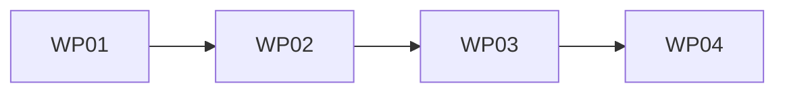

# Tasks: troupe configuration: sync with files

**Mission**: `troupe-config-sync-files-01M3ZT6R` · **Spec**: [spec.md](spec.md) · **Plan**: [plan.md](plan.md)
**Planning/merge branch**: `feat/troupe-config-sync-files` (delivered to `main` by local merge after acceptance)

Every WP ships tests for every behaviour it adds or changes (charter TROUPE-005; spec NFR-006), and must pass
`uv run pytest`, `uv run mypy --strict`, `uv run ruff check` and `uv run ruff format --check` before it goes to review.

## Subtask Index

| ID | Description | WP | Parallel |
|----|-------------|----|----------|
| T001 | `ConfigHistory.leaves` state maintained by event bodies; `HistoryStore.recorded_leaves()` (`history.py`) | WP01 | [P] |
| T002 | Unit tests: recorded leaves after import/set/remove, after reopen (replay), step-1 tolerant replay; `records()` unchanged | WP01 | |
| T003 | `theatre_lock(state_dir)`: exclusive flock on the `.troupe` directory fd (`lock.py`) | WP01 | [P] |
| T004 | Unit tests: lock excludes another process, is released on exit, creates no file, error names the dir | WP01 | |
| T005 | `reconcile(store, tree)` and `watched_files(tree)` (`reconcile.py`) | WP02 | |
| T006 | `open_session(theatre, *, reconcile)`: lock, re-locate, load, import-or-reconcile (`session.py`) | WP02 | |
| T007 | `show`/`set` reconcile first, `history` never (`commands/show.py`, `set_value.py`, `history.py`) | WP02 | |
| T008 | Unit tests for reconcile ordering, no-op edits, type changes, `watched_files` | WP02 | [P] |
| T009 | Rewrite step-1 tests superseded by reconcile (research R-10) | WP02 | |
| T010 | Integration tests: reconcile-first (US1 scenarios 1–10, D-7, NFR-004) | WP02 | |
| T011 | CLI: `watch` subparser, theatre-as-given, long-running dispatch with announce/report (`cli.py`) | WP03 | |
| T012 | `watch` startup: session, baseline, readiness line (`commands/watch.py`) | WP03 | |
| T013 | `watch` poll loop: byte comparison, reconcile on change, new baseline | WP03 | |
| T014 | `watch` unloadable handling: retry each tick, report once per distinct message | WP03 | |
| T015 | `watch` signals: SIGINT/SIGTERM stop flag, exit 0 | WP03 | |
| T016 | Test harness: `WatchProcess` and `wait_for_history` helpers (`tests/conftest.py`) | WP03 | [P] |
| T017 | Integration tests: `watch` (US2 scenarios 1–9, NFR-001/002/005) | WP03 | |
| T018 | Integration tests: includes added/removed by hand, via a command and via `watch` (US4) | WP04 | [P] |
| T019 | Integration tests: `set` while `watch` runs records only its own events (US3 1–3, 5) | WP04 | [P] |
| T020 | Integration tests: near-simultaneous hand edit + `set`/`show` recorded exactly once (US3 4, FR-016) | WP04 | |
| T021 | Fix any defect the acceptance tests expose (justified out-of-map edits only) | WP04 | |
| T022 | Quickstart walk-through and full quality gates; spec/plan/code agreement check | WP04 | |

## Phase 1 — Foundation

### WP01 — Recorded configuration and theatre lock

- **Prompt**: [tasks/WP01-recorded-config-and-lock.md](tasks/WP01-recorded-config-and-lock.md)
- **Goal**: The history can answer "what is the recorded configuration?" (path → value), and there is one lock that serialises every history-changing session.
- **Priority**: P1 (foundation for every other WP)
- **Independent test**: Unit tests on a real SQLite store and real processes. The recorded leaves equal the replayed events. A second process cannot take the lock while the first holds it.
- **Subtasks**:
  - T001 `ConfigHistory.leaves` + `HistoryStore.recorded_leaves()` (WP01)
  - T002 recorded-leaves unit tests (WP01)
  - T003 `theatre_lock` (WP01)
  - T004 lock unit tests (WP01)
- **Implementation sketch**: Event bodies update `self.leaves`, and `leaf_removed` uses `pop(path, None)` to tolerate step-1 histories. `lock.py` opens the `.troupe` directory and calls `flock(LOCK_EX)`.
- **Parallel**: T001/T002 and T003/T004 are independent.
- **Dependencies**: none.
- **Risks**: `history` output must stay byte-identical for existing histories. The lock must create no file.
- **Estimated prompt size**: ~300 lines.

## Phase 2 — Reconcile (User Story 1)

### WP02 — Reconcile and reconcile-first commands

- **Prompt**: [tasks/WP02-reconcile-first.md](tasks/WP02-reconcile-first.md)
- **Goal**: `show` and `set` record hand edits made while nothing was running, before doing their own work. `history` never does.
- **Priority**: P1
- **Independent test**: Import a theatre, hand-edit it, run `show`/`set`/`history`, and compare `history` JSON Lines exactly. Snapshot all files to prove reconcile writes nothing.
- **Subtasks**:
  - T005 `reconcile.py` (WP02)
  - T006 `session.py` (WP02)
  - T007 command wiring (WP02)
  - T008 reconcile unit tests (WP02)
  - T009 rewrite superseded step-1 tests (WP02)
  - T010 reconcile-first integration tests (WP02)
- **Implementation sketch**: `reconcile = diff(recorded, flatten(tree))` → `record`. The session runs lock → locate → load → import or reconcile → yield. Commands pass `reconcile=True/False`.
- **Parallel**: T008 can be written alongside T006/T007.
- **Dependencies**: WP01.
- **Risks**: This deliberately changes step-1 behaviour, so the superseded tests are rewritten, never deleted. Reconcile events are kept when the command later fails (D-7).
- **Estimated prompt size**: ~420 lines.

## Phase 3 — Watch (User Story 2)

### WP03 — `troupe config watch`

- **Prompt**: [tasks/WP03-watch-command.md](tasks/WP03-watch-command.md)
- **Goal**: A foreground command that prints `watching <dir>` once it can observe changes, records hand edits within 2 seconds, survives unloadable edits, and exits 0 on SIGINT/SIGTERM.
- **Priority**: P1
- **Independent test**: Run `watch` as a real subprocess, wait for the line, edit files, poll `history` against a 2-second deadline, then send a signal and check exit 0 and stdout.
- **Subtasks**:
  - T011 CLI wiring (WP03)
  - T012 startup (WP03)
  - T013 poll loop (WP03)
  - T014 unloadable handling (WP03)
  - T015 signals (WP03)
  - T016 test harness (WP03)
  - T017 watch integration tests (WP03)
- **Implementation sketch**: The CLI passes `announce`/`report` callbacks and the theatre string as given. `watch` takes its baseline inside the startup session from the loaded texts, then polls every 0.25 s until a `threading.Event` is set by the signal handler.
- **Parallel**: T016 (harness) can be written before T012–T015.
- **Dependencies**: WP02.
- **Risks**: Timing-sensitive tests must use deadlines, never bare sleeps, as assertions, and must always kill the child in `finally`. The readiness line must not precede the baseline.
- **Estimated prompt size**: ~480 lines.

## Phase 4 — Acceptance (User Stories 3 and 4) and delivery

### WP04 — Includes, write-back non-detection, exactly-once, delivery checks

- **Prompt**: [tasks/WP04-includes-and-write-back-acceptance.md](tasks/WP04-includes-and-write-back-acceptance.md)
- **Goal**: Prove that includes added or removed by hand are followed, that a `set` during `watch` records only its own events, and that each hand edit is recorded exactly once even when `watch` and a command race. Then run the quickstart and every gate.
- **Priority**: P1 (US3) / P2 (US4)
- **Independent test**: Black-box acceptance suites `test_watch_includes.py` and `test_watch_set.py`.
- **Subtasks**:
  - T018 includes tests (WP04)
  - T019 set-during-watch tests (WP04)
  - T020 exactly-once race tests (WP04)
  - T021 defect fixes (WP04)
  - T022 quickstart + gates (WP04)
- **Implementation sketch**: Tests only, unless they expose a defect. Fixes go into the owning module, with a one-line rationale in the commit.
- **Parallel**: T018 and T019 are independent files.
- **Dependencies**: WP03.
- **Risks**: Flaky timing. Each race test repeats a bounded number of iterations with deadlines. A hand edit *during* a `set`'s locked section is out of contract (C-003) and is not tested.
- **Estimated prompt size**: ~360 lines.

## Dependency graph

MVP: WP01 + WP02 (edits made while nothing runs are picked up). WP03 adds the live command, and WP04 proves the concurrency guarantees.
